# AutoCAM Module 3 — illustrated user manual and verification record

**Where to start:** Use the [user guide](MODULE3_USER_GUIDE.md) for the operating sequence and the [developer guide](MODULE3_DEVELOPER_GUIDE.md) for setup and verification. This longer document preserves detailed, dated screenshots, results and reviewer responses. Start at the [V2 baseline and training walkthrough](#fresh-training-workflow) or [full-sequence inference](#full-sequence-inference). The [hosted app](https://mingwucn.github.io/AutoCAM_UI/rrv2_module3/?case=industrial_reach_00350#gym) is separate from the source files displayed on GitHub.

**Draft · 26 October 2026.** This document covers the single [AutoCAM_UI repository](../README.md) and its [hosted application](../index.html). It explains the workflow, the observed results and the remaining limits. It is not an independent human acceptance record or manufacturing approval. Video is deferred.

<a id="industrial-reach-workflow"></a>

The current public workflow is **Reusable Results V2 — Module 3**. Read the
[important drilling milestone](MILESTONES.md) and
[documentation consistency review](DOCUMENT_CONSISTENCY_REVIEW.md).

Current drilling controls: **Preview next action** selects an eligible cut from your accepted stock without applying it. **Show bore section** centres the linked views on the source bore. During sequence replay, use **Return to my stock** or **Return to stock and preview next action** to resume. Loading an alternative preserves stock; **Restore industrial decisions** explicitly adopts a checked recording. A complete restored run has no further cuts. See the [current drilling and sequence controls](../rrv2_module3/guide/index.html#drilling-controls). The screenshots below retain their original [v10 recording identity](../rrv2_module3/source-pins-v10.json).

Source bore `00350-bore-z-24` is Ø24 mm and 23 mm deep. Modeled reach is measured
from the original stock reference, so its value is distinct from source depth.
The bore axis and cylinder are logical removal guides; physical tool and holder
geometry are outside this workflow's model.

<a id="full-sequence-inference"></a>

## Full-sequence inference — fresh screenshots, 26 October 2026

Open [Reusable Results V2 — Module 3](../rrv2_module3/index.html?case=industrial_reach_00350#gym).
This update adds **Run full-sequence inference** to **Model guidance**. The earlier
[baseline → preference → random experience → Train model walkthrough](#fresh-training-workflow)
remains below. Its baseline, policy and MCTS results retain their dated source identity.

| Control | What it does | Starting material / model |
| --- | --- | --- |
| **Train model** | Fits weights from saved sequences and explicit labels; random experience is included when saved. | Selected training starting model; saved input only. |
| **Suggest industrial policy** | Suggests one next action. Use Preview suggested action and Apply to accept it. | Current accepted stock; loaded compatible model. |
| **Run full-sequence inference** | Generates successive policy actions and the complete action table without training. | Original stock; a snapshot of the loaded compatible model. |
| **Run inference and compare** | Compares full rollouts and next choices for the last successful training's exact before/after pair. | Identical original stock and identical-state probes; retained training pair. |
| **Search industrial MCTS** | Searches for one next command using the selected simulation count and depth. | Current accepted stock; loaded model. The dated walkthrough below retains the separate complete MCTS record. |

### 1. Load a compatible model and run the whole sequence

Choose **Use initial model**, or **Load industrial model** and select a compatible
checkpoint. To reproduce the imported example, use the retained
[Run B checkpoint](verification/full-sequence-inference/b-loaded-model.json)
from the earlier seeded-random training. Loading it requires no new **Train model**
click. Then choose **Run full-sequence inference**. While it runs, **Cancel industrial
computation** preserves the previous completed result. A guard-limited rollout is
reported as partial; check its remaining material rather than assuming completion.

The fresh recording deliberately kept **one accepted turning cut** before both
runs. Both inferred episodes nevertheless start from original stock. No training,
new random generation or feedback edit occurred during these inference checks.

[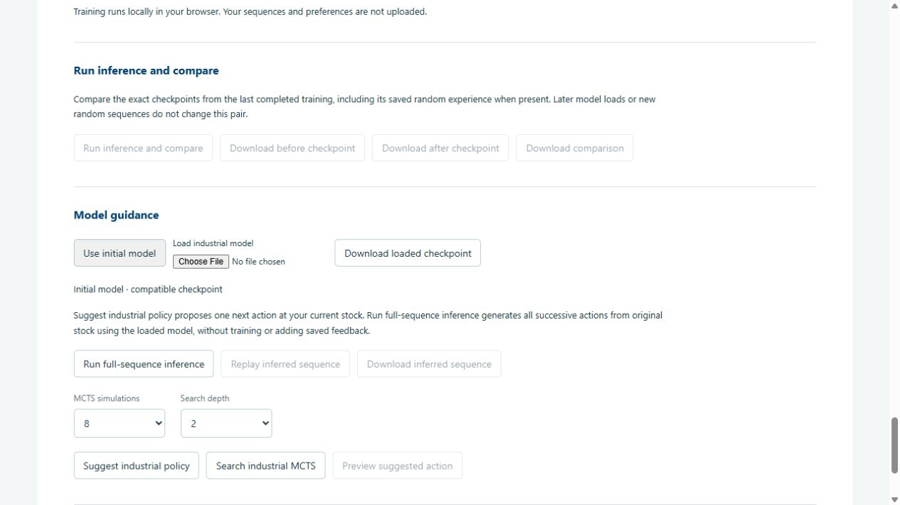](images/industrial-reach/full-01-controls-initial.jpg)

*Use initial model loads a compatible checkpoint. Run full-sequence inference is available without a completed training pair; Run inference and compare requires that pair.*

[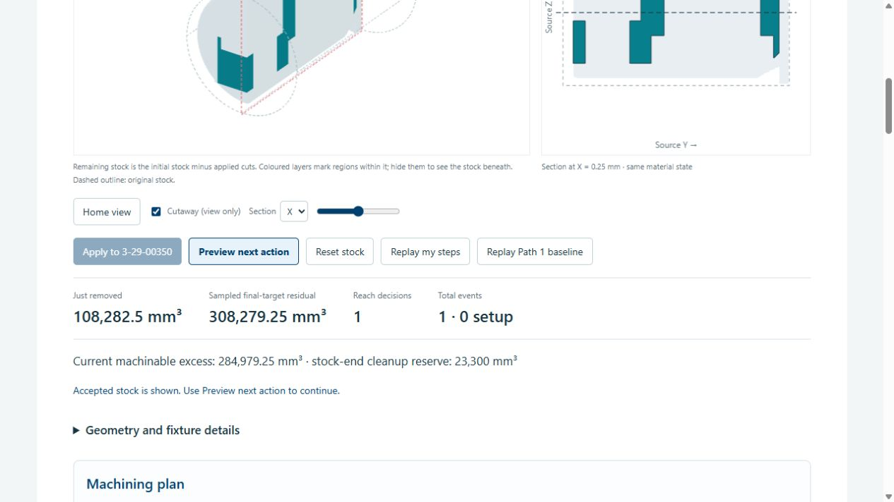](images/industrial-reach/full-02-accepted-stock-before.jpg)

*One turning cut was accepted before inference: 308,279.25 mm³ sampled residual. Full inference still starts from original stock.*

### 2. Inspect every decision and its frozen model identity

The **Last inferred sequence** summary names the model used, cut count, residual
and sampled completion. Each row lists **process, engagement direction, tool reach
and remaining material**. **Finishing pass** badges identify the final profiling
actions. Expand **Model identity used for this result** and use **Download inferred
sequence model** to retain the exact model associated with that result. A later
model load changes the current model, while the existing result keeps its own identity.

Fresh Initial inference produced **11 cuts**; the imported Run B checkpoint produced
**24 cuts**. Both reached **0 mm³ sampled residual**, with drilling, cleanup and four
finishing decisions. More cuts do not establish better machining. The earlier
controlled A/B comparison below isolates the added random episode; this new check
demonstrates inference from those saved weights without retraining.

[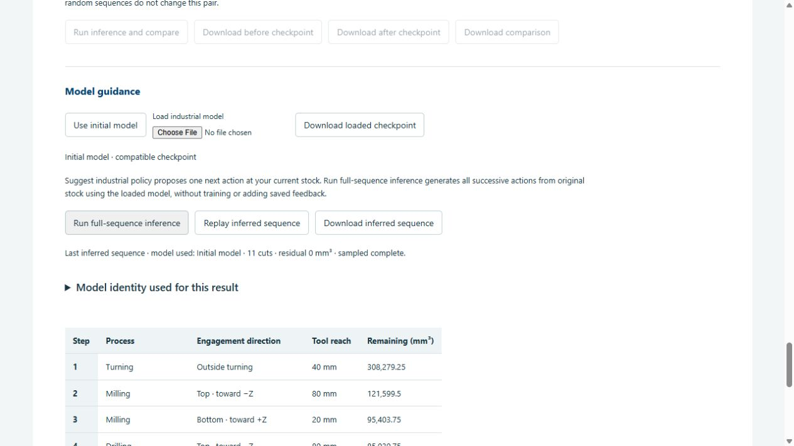](images/industrial-reach/full-04-initial-result.jpg)

*Initial model: 11 cuts, 0 mm³ sampled residual, sampled complete. This is a fresh button execution on 26 October.*

[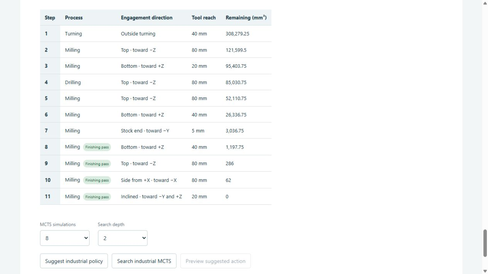](images/industrial-reach/full-05-initial-all-actions.jpg)

*All 11 rows show process, engagement direction, reach and remaining material. Drilling is row 4; stock-end cleanup is row 7; finishing passes are rows 8–11.*

[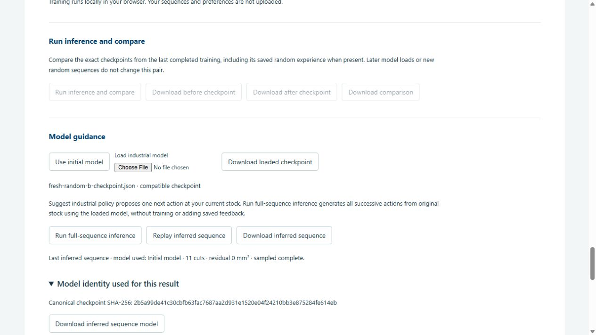](images/industrial-reach/full-06-b-loaded-old-result.jpg)

*The loaded checkpoint is now fresh-random-b-checkpoint.json. The previous result still names Initial model and retains its original model identity until inference is run again.*

[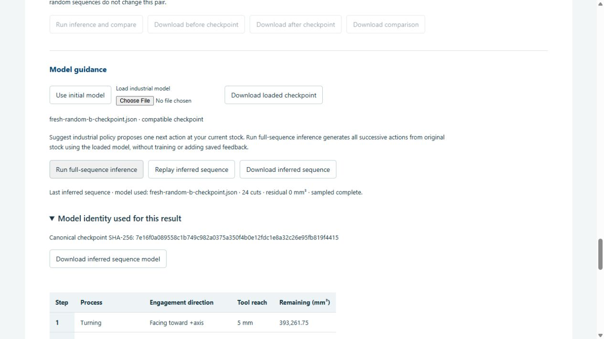](images/industrial-reach/full-07-b-result.jpg)

*B completes in 24 cuts with 0 mm³ sampled residual. Model identity used for this result exposes the canonical checkpoint hash and Download inferred sequence model.*

[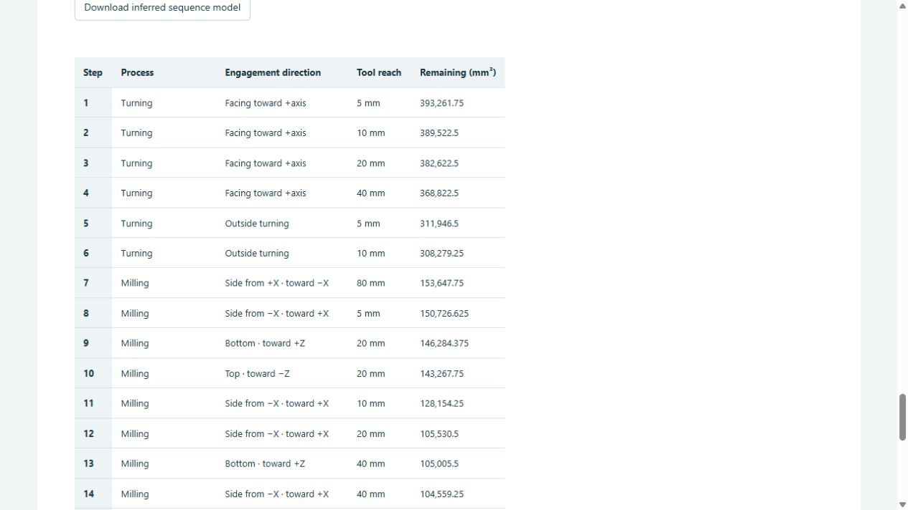](images/industrial-reach/full-08-b-actions-first.jpg)

*The imported policy starts with facing toward +axis at 5 mm reach. It differs from Initial outside turning at 40 mm. These are observed decisions, without an efficiency claim.*

[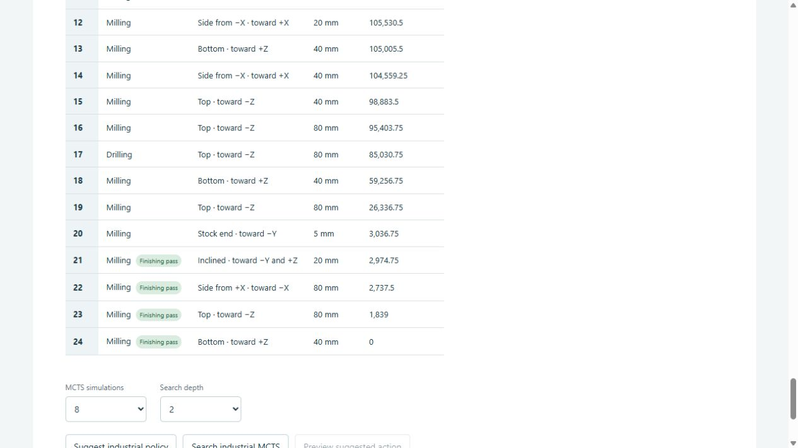](images/industrial-reach/full-09-b-actions-finishing.jpg)

*Rows 12–24 overlap the preceding capture. Drilling is row 17, stock-end cleanup row 20 and the four finishing passes are rows 21–24. The final residual is zero.*

### 3. Replay, download and return to accepted stock

Choose **Replay inferred sequence**, then **Next** to inspect the checked event
states. **Apply** remains disabled during replay. Choose **Return to my stock** to
resume the independent accepted stock. **Download inferred sequence** retains the
actual generated episode; **Download inferred sequence model** retains its model.
**Download loaded checkpoint** describes the currently selected model, which can
differ from a previous result's frozen model.

[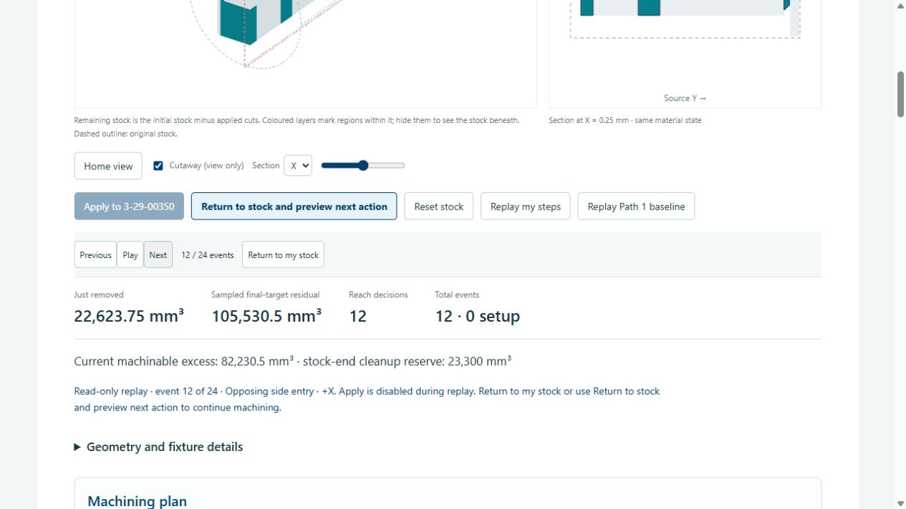](images/industrial-reach/full-10-b-replay-middle.jpg)

*Next advances the displayed episode. Apply is disabled; the midpoint residual is 105,530.5 mm³.*

[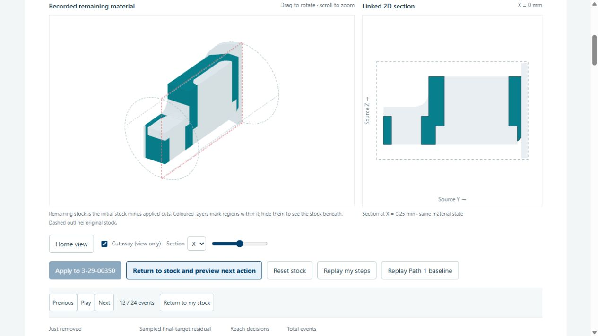](images/industrial-reach/full-11-b-replay-material.jpg)

*The 3D material view and 2D section show the same event 12 / 24. View controls do not accept machining decisions.*

[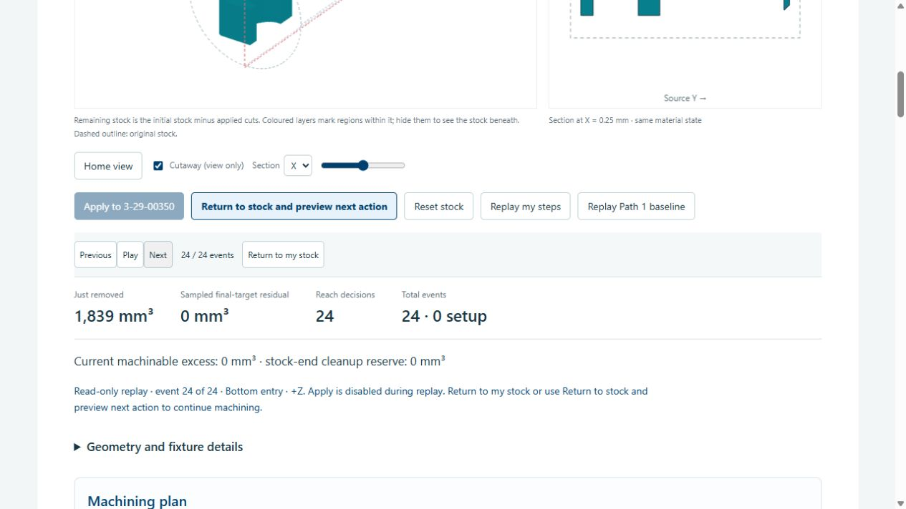](images/industrial-reach/full-12-b-replay-complete.jpg)

*At 24 / 24 events the sampled residual is zero. The replay checks all 12 listed features and records the nine finishing checks.*

[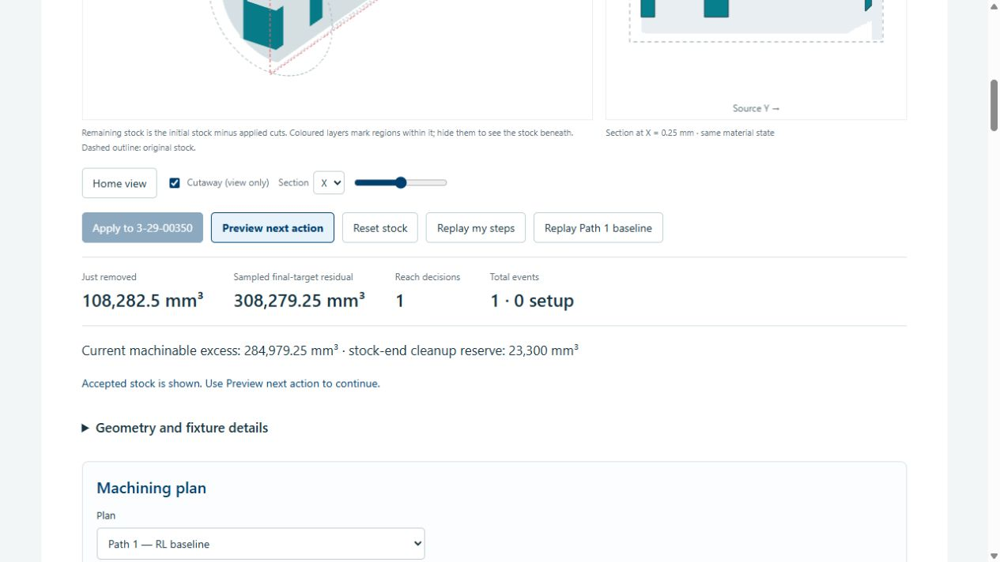](images/industrial-reach/full-13-accepted-stock-after.jpg)

*The original one-cut accepted stock returns with the same 308,279.25 mm³ residual. The retained before/after stock and training-input downloads are compared separately.*

The fresh raw [Initial episode](verification/full-sequence-inference/initial-inferred-sequence.json),
[B episode](verification/full-sequence-inference/b-inferred-sequence.json),
[Initial result model](verification/full-sequence-inference/initial-result-model.json),
[B result model](verification/full-sequence-inference/b-result-model.json) and
[capture inventory](verification/full-sequence-inference/recording.json) are portable
relative downloads. See the [verification record](verification/full-sequence-inference/README.md)
for source identity, replay and before/after checks. Training comparison stays
unavailable in this fresh page because no training pair was created here; importing
a checkpoint alone does not recreate its training report.

<a id="fresh-training-workflow"></a>

## V2 recorded workflow: baseline, random experience, training and inference

Open [Reusable Results V2 — Module 3](../rrv2_module3/index.html?case=industrial_reach_00350#gym)
and the [recorded v10 walkthrough](../rrv2_module3/guide/index.html#fresh-recording).
These screenshots record the local workflow after publication of the verified
random-experience update on 23 October 2026. Every image opens its untouched
capture for full-size reading. Live app captures are 1265 × 712; the separately
labelled derived numerical records are 1280 × 720.

Use two trainings from the same **Initial model** to examine the effect of adding
random experience. Run A uses three saved reference episodes and one explicit
Path 2-over-Path 1 preference. Run B adds one seeded random episode. Keep each
run's exact input, checkpoint, report and comparison; continuing Run A's weights
would change the starting point. Training and inference use the same sampled
simulator and its hard material gates.

### 1. Inspect original stock and preview the first cut

Choose **Turning**, **Outside turning**, and **Tool reach 40 mm**. The controls
describe process, source-coordinate engagement direction and modeled penetration
limit. Orange material is the current cut preview. Preview alone preserves
accepted stock; **Apply to 3-29-00350** accepts an eligible positive decision.
The linked section and 3D view describe the same material state.

[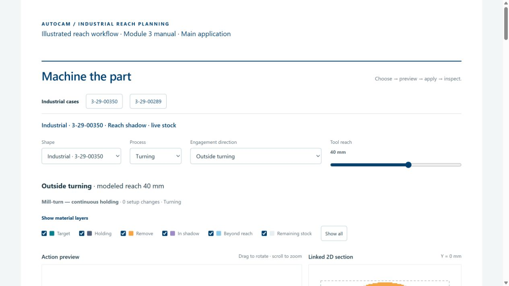](images/industrial-reach/01-original-stock.jpg)

*Step 1 — Original stock and explicit process, engagement direction and tool-reach controls. Continuous holding is the declared setup assumption.*

[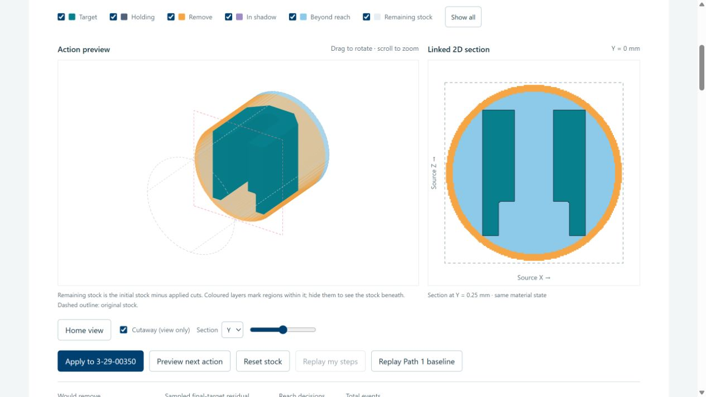](images/industrial-reach/02c-original-stock-material.jpg)

*Step 1 — The orange turning preview is visible before Apply. Rotation, cutaway and section controls change the view.*

### 2. Apply and record all 11 Path 1 decisions

In **Baseline and model → Record and replay**, select **Path 1 — user plan** and
**Load selected baseline**. Inspect its seven main stages. Use **Preview next
baseline action**, inspect the process/direction/reach and positive removal, then
**Apply**. Repeat for all 11 decisions below. The recording accepted these 11
decisions through the live controls; the saved named reference episode is a
separate training input.

| Apply | Process / phase | Engagement direction | Reach (mm) | Just removed (mm³) | Sampled residual (mm³) |
| --- | --- | --- | ---: | ---: | ---: |
| 1 | Turning | Outside | 40 | 108,282.5 | 308,279.25 |
| 2 | Bulk milling | Top · toward −Z | 80 | 186,679.75 | 121,599.5 |
| 3 | Bulk milling | Bottom · toward +Z | 80 | 26,195.75 | 95,403.75 |
| 4 | Drilling | Top · toward −Z | 80 | 10,373 | 85,030.75 |
| 5 | Deep-feature milling | Top · toward −Z | 80 | 32,920 | 52,110.75 |
| 6 | Deep-feature milling | Bottom · toward +Z | 80 | 25,774 | 26,336.75 |
| 7 | Stock-end cleanup | Stock end · toward −Y | 5 | 23,300 | 3,036.75 |
| 8 | Final profiling | Top · toward −Z | 80 | 911.75 | 2,125 |
| 9 | Final profiling | Bottom · toward +Z | 80 | 1,839 | 286 |
| 10 | Final profiling | Side from +X · toward −X | 80 | 224 | 62 |
| 11 | Final profiling | Inclined · toward −Y and +Z | 20 | 62 | 0 |

Three bulk decisions leave **95,403.75 mm³** sampled residual. The bore therefore
still requires **Drilling**, followed by the deep-feature passes, a positive
stock-end cleanup and four final-profiling decisions. The side stage has no
additional removal after this top/bottom bulk ordering and adds no zero-removal
event. Main stages group decisions; they do not count tool changes.

[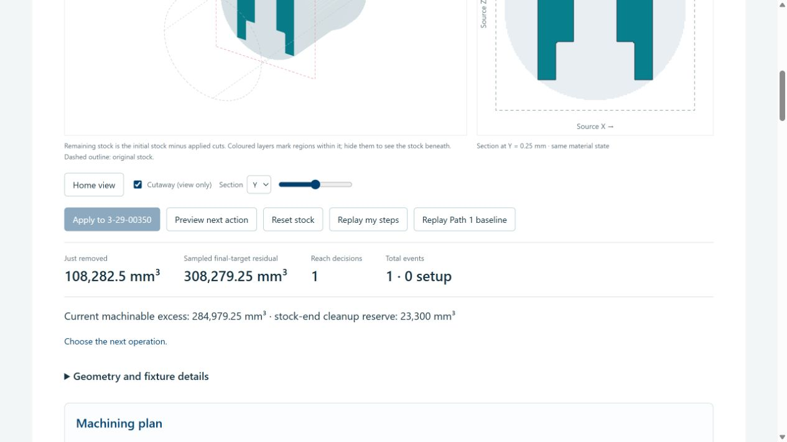](images/industrial-reach/03-path1-after-turning.jpg)

*Apply 1 — Turning, outside, 40 mm reach. Accepted removal 108,282.5 mm³; sampled residual 308,279.25 mm³.*

[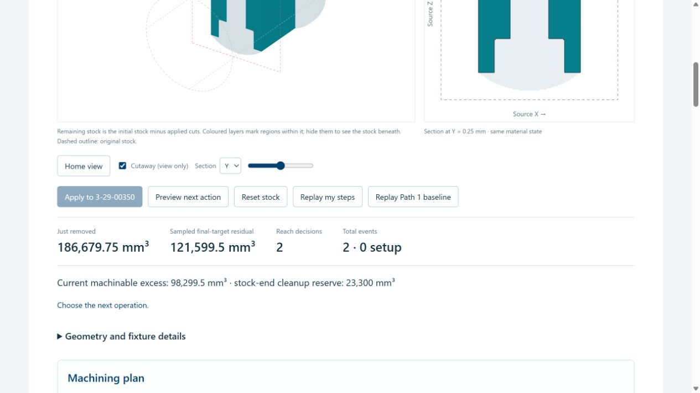](images/industrial-reach/04-path1-after-top.jpg)

*Apply 2 — Bulk milling, top · toward −z, 80 mm reach. Accepted removal 186,679.75 mm³; sampled residual 121,599.5 mm³.*

[](images/industrial-reach/05-path1-after-three-bulk.jpg)

*Apply 3 — Bulk milling, bottom · toward +z, 80 mm reach. Accepted removal 26,195.75 mm³; sampled residual 95,403.75 mm³.*

[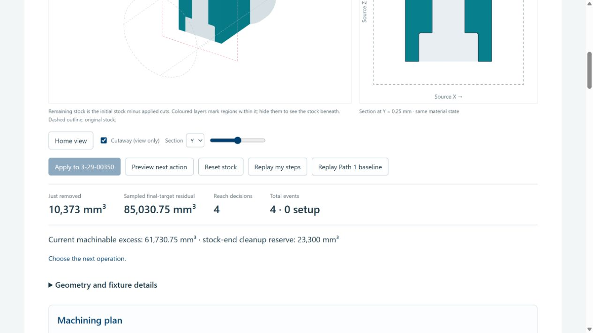](images/industrial-reach/07b-path1-after-drilling-confirmed.jpg)

*Apply 4 — Drilling, top · toward −z, 80 mm reach. Accepted removal 10,373 mm³; sampled residual 85,030.75 mm³.*

[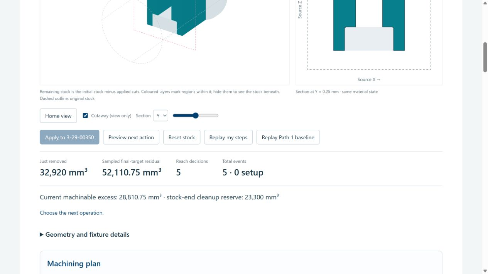](images/industrial-reach/08-path1-deep-top.jpg)

*Apply 5 — Deep-feature milling, top · toward −z, 80 mm reach. Accepted removal 32,920 mm³; sampled residual 52,110.75 mm³.*

[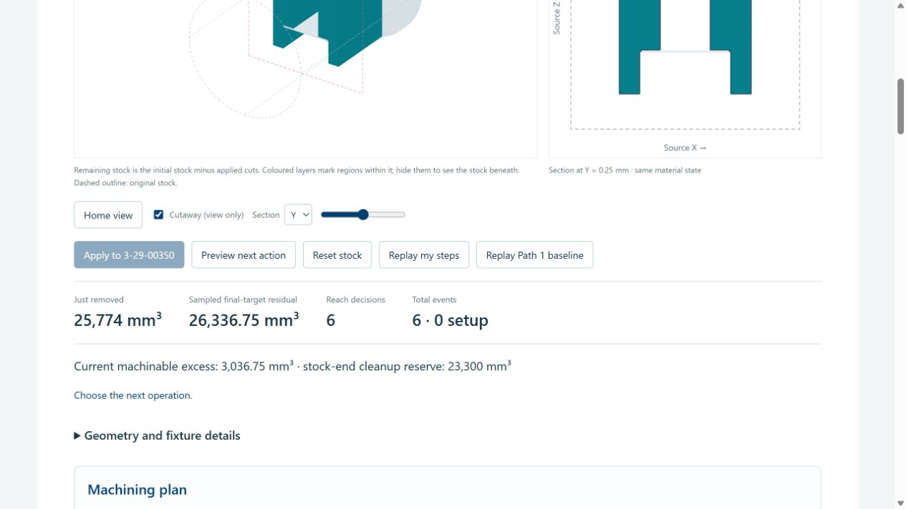](images/industrial-reach/09-path1-deep-bottom.jpg)

*Apply 6 — Deep-feature milling, bottom · toward +z, 80 mm reach. Accepted removal 25,774 mm³; sampled residual 26,336.75 mm³.*

[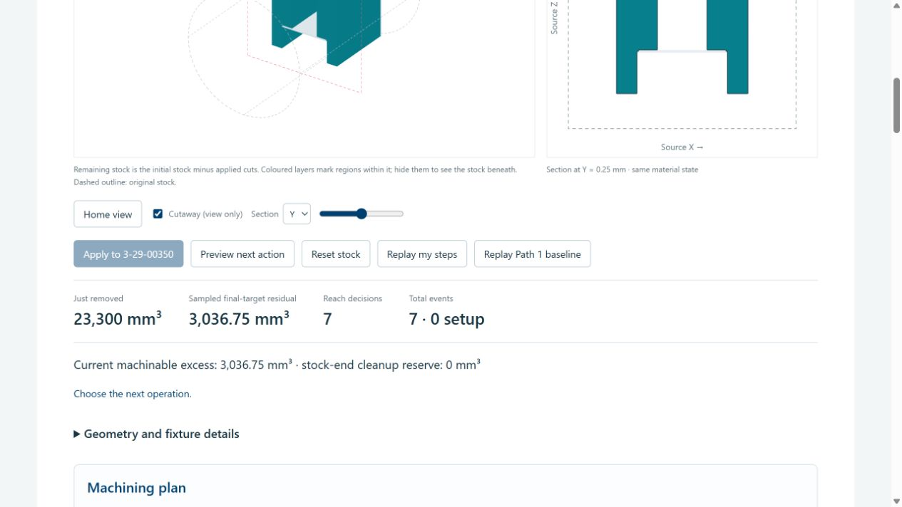](images/industrial-reach/10-path1-after-cleanup.jpg)

*Apply 7 — Stock-end cleanup, stock end · toward −y, 5 mm reach. Accepted removal 23,300 mm³; sampled residual 3,036.75 mm³.*

[](images/industrial-reach/11-path1-finish-top.jpg)

*Apply 8 — Final profiling, top · toward −z, 80 mm reach. Accepted removal 911.75 mm³; sampled residual 2,125 mm³.*

[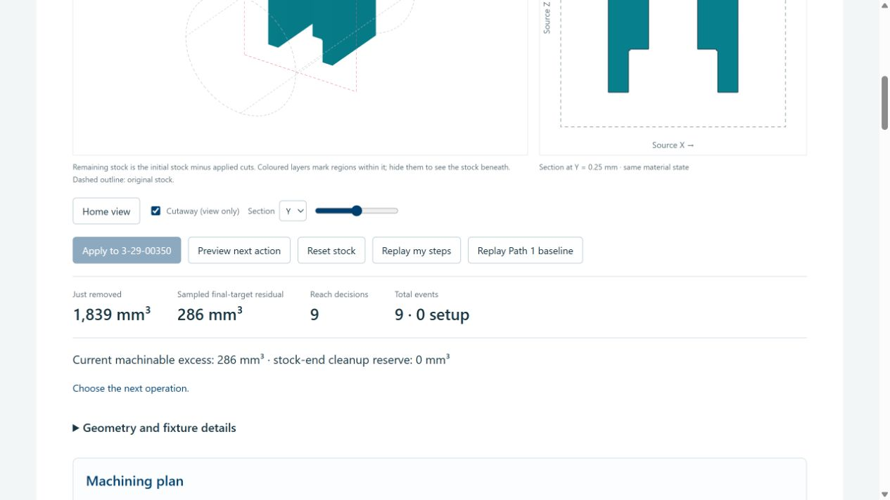](images/industrial-reach/12-path1-finish-bottom.jpg)

*Apply 9 — Final profiling, bottom · toward +z, 80 mm reach. Accepted removal 1,839 mm³; sampled residual 286 mm³.*

[](images/industrial-reach/13-path1-finish-side.jpg)

*Apply 10 — Final profiling, side from +x · toward −x, 80 mm reach. Accepted removal 224 mm³; sampled residual 62 mm³.*

[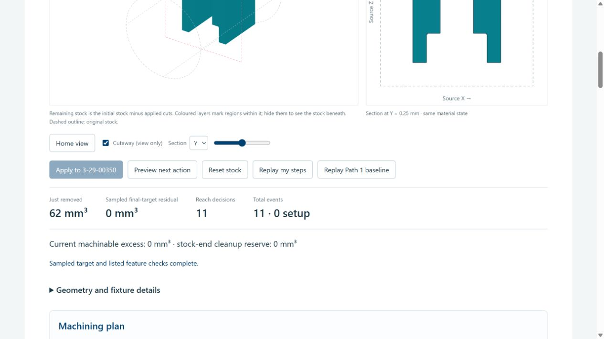](images/industrial-reach/14-path1-complete.jpg)

*Apply 11 — Final profiling, inclined · toward −y and +z, 20 mm reach. Accepted removal 62 mm³; sampled residual 0 mm³.*

### 3. Check completion and retain the manual recording

After Apply 11, the app reports **0 mm³ sampled final-target residual**, **11
reach decisions**, **0 setup changes**, and **Sampled target and listed feature
checks complete**. Expand **Feature progress** to inspect all 12 listed features.
The nine finishing rows require their designated final passes. Four accepted
final-profiling decisions cover those nine checks.

Choose **Download industrial decisions** to retain the actual manual episode.
**Download baseline** retains the named Path 1 reference separately. Use
**Reset stock** and **Restore industrial decisions** to check a saved episode.
Manual unsaved history is excluded from training. **Use current sequence as
baseline** saves it explicitly and clears previous sequence labels; add the
intended preference again after replacing either recording.

[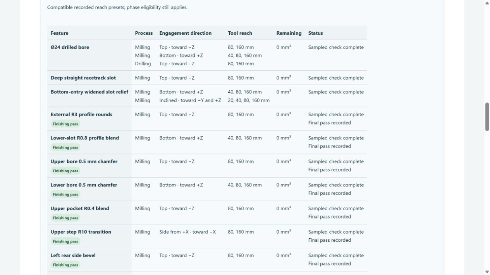](images/industrial-reach/15d-path1-feature-checks-middle.jpg)

*Step 3 — Bore, deep slot, relief and upper/middle finishing checks after the actual 11-Apply baseline.*

[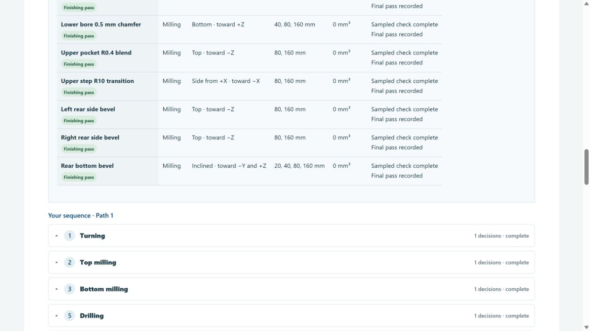](images/industrial-reach/15c-path1-feature-checks-lower-confirmed.jpg)

*Step 3 — Remaining lower finishing checks show Final pass recorded. Compatible reach presets are contributing modeled envelopes, not minimum physical tool requirements.*

### 4. Save an explicit preference, then include Greedy

Compare **Path 2 — Preferred** with Path 1. Path 2 has eight main stages and 13
positive decisions, including bottom milling. The recording first chose **Clear
preference labels**, then selected **Path 2** and clicked **Add whole-sequence
preference**. Confirm **Saved feedback: 1 sequence label(s), 0 action-kind
label(s)** and **Path 2 preferred over Path 1**.

[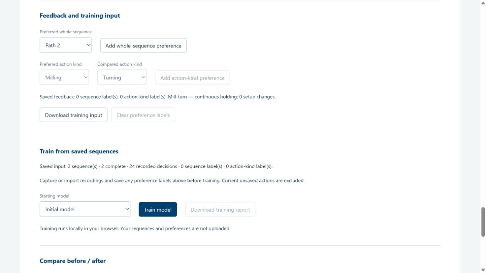](images/industrial-reach/16a-preference-cleared.jpg)

*Step 4 — Clearing the labels establishes the explicit starting point before adding the intended whole-sequence preference.*

[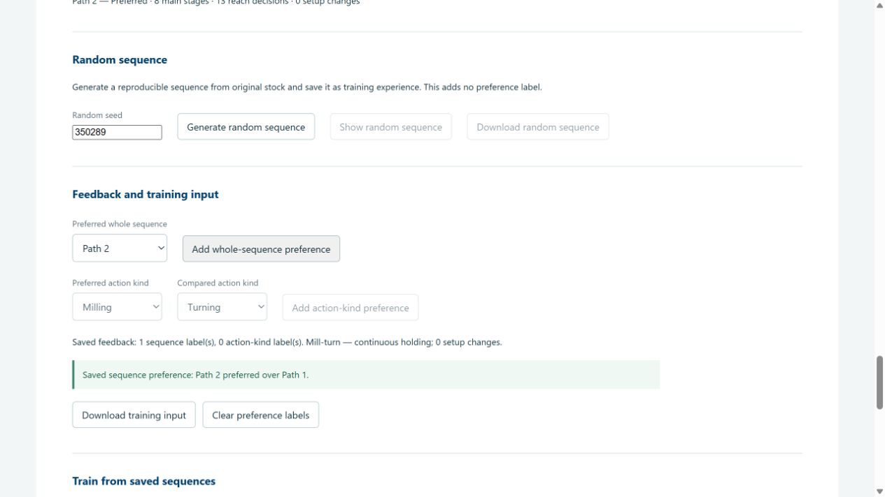](images/industrial-reach/16c-path2-preference-confirmed.jpg)

*Step 4 — The saved label compares the two complete named sequences. No action-kind preference was added.*

Select **Greedy — maximum current removal** and **Load selected baseline** after
saving the label. Path 1 remains the preference anchor. **Saved input** now shows
**3 complete sequences, 35 recorded decisions, 1 sequence label and 0 action-kind
labels**: Path 1 (11), Greedy (11) and Path 2 (13). Choose **Download training
input** and retain it as Run A's exact input.

[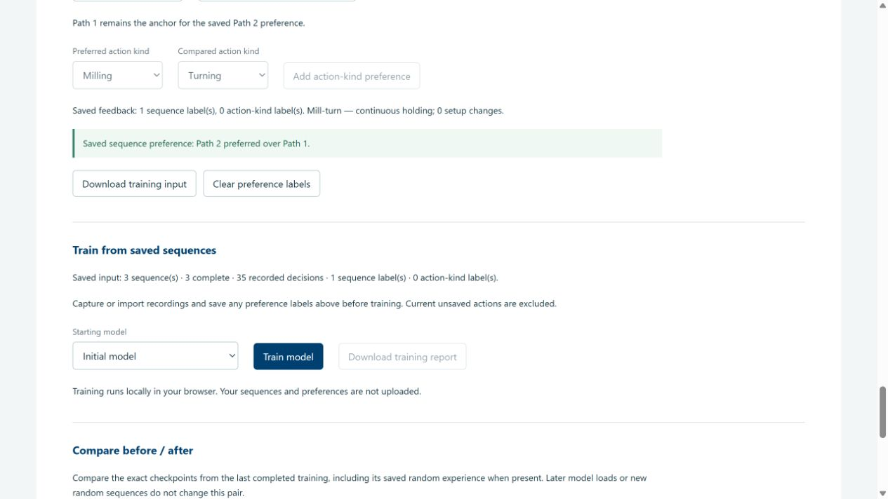](images/industrial-reach/17-control-a-training-input.jpg)

*Step 4 — Run A includes three saved reference episodes. The manually applied history remains independent and unsaved actions are excluded.*

### 5. Train Run A in the browser and retain its result

In **Train from saved sequences**, keep **Starting model → Initial model**, then
choose **Train model**. Computation runs locally in the browser; sequences and
preferences are not uploaded. The progress text reports each stage's own count.
**Cancel training** preserves the previous model, accepted stock and feedback.
Browser records should be downloaded before refresh.

[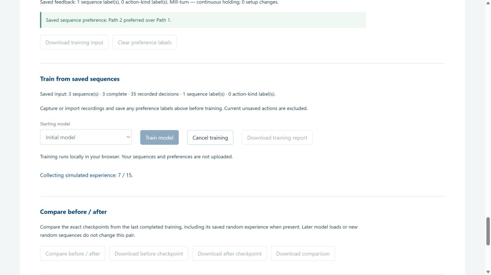](images/industrial-reach/18c-control-a-simulated-experience.jpg)

*Step 5 — Actual browser training in progress: collecting simulated experience 7 / 15. This is a stage count, not an overall percentage.*

On success, the checked **Browser-trained model** loads automatically. Retain
**Download training report**, **Download loaded checkpoint**, **Download before
checkpoint** and **Download after checkpoint**. The Run A report records **140
simulated cutting transitions**, **28,000 TD updates** and **1 explicit preference
label**, using 200 reward epochs, 200 TD epochs, 12 exploration episodes and seed
350289. The fitted preference probability changes from **0.49446 to 0.72787**;
that probability is a model output, not measured machining quality.

[](images/industrial-reach/19-control-a-training-complete.jpg)

*Step 5 — Completed Run A training. The downloaded loaded checkpoint is byte-identical to this run’s downloaded after checkpoint.*

Choose **Run inference and compare** (captioned **Compare before / after** in the dated v10 captures) and **Download comparison** before Run B.
Run A's checked full rollouts are Path 1 **11**, Greedy **11**, Path 2 **13**,
Initial policy **11** and trained A policy **20** decisions. All five reach zero
sampled residual. At the 11 identical prefixes of the Initial policy, A changes
**7** next choices and retains **4**. These checked rollouts are numerical
inference results; the 11 baseline Apply clicks above are the separately recorded
manual execution. More cuts and changed choices do not establish better machining.

[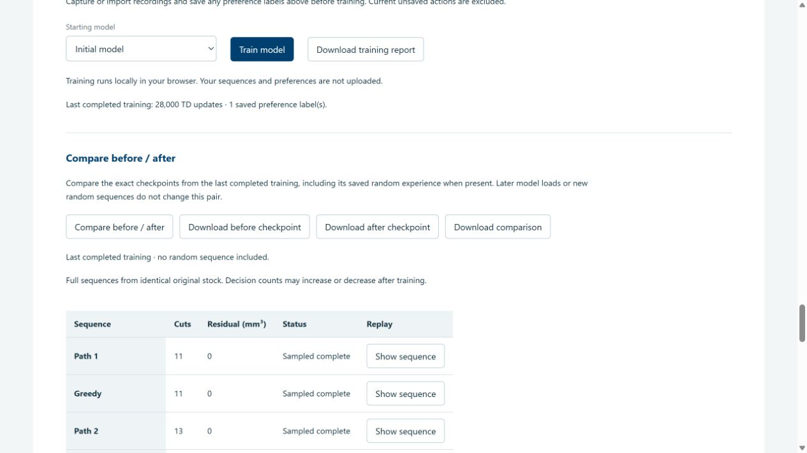](images/industrial-reach/19b-control-a-five-row-comparison.jpg)

*Step 5 — Run A comparison uses its retained Initial/after pair and no random episode. Download the comparison before the next training replaces this pair.*

### 6. Generate, inspect and save the random episode

Keep Run A's three saved episodes and the explicit label unchanged. Set **Random
seed** to **350289**, then **Generate random sequence**. This run saved a
**16-cut**, **sampled-complete** episode with **0 mm³ sampled residual**. Random
generation starts from original stock and accepts eligible positive actions. It
preserves live stock and adds no preference label.

[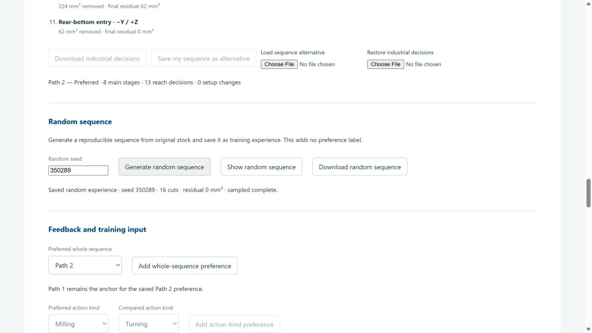](images/industrial-reach/25-random-experience-saved.jpg)

*Step 6 — The actual generated random episode is saved separately. The Path 2-over-Path 1 preference remains intact.*

Choose **Show random sequence**. Use **Next** to inspect the saved 0 / 16,
8 / 16 and 16 / 16 event states. Apply stays disabled in this read-only replay.
Choose **Return to my stock** to return to accepted stock. The recording returned
to zero accepted live cuts before starting Run B. **Download random sequence**
retains the exact generated experience.

[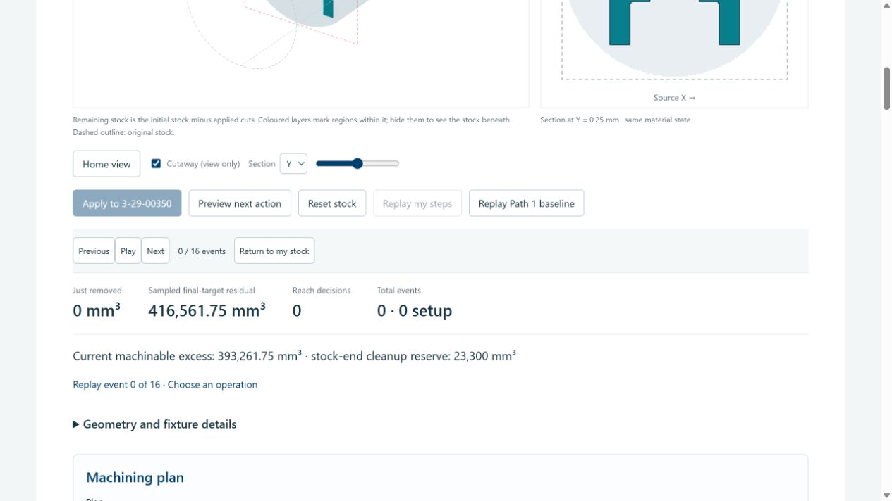](images/industrial-reach/26a-random-replay-start.jpg)

*Step 6 — Read-only random replay at 0 / 16 events. The displayed replay history does not replace the independent accepted live stock.*

[](images/industrial-reach/26b-random-replay-middle.jpg)

*Step 6 — Read-only random replay at 8 / 16 events. The displayed replay history does not replace the independent accepted live stock.*

[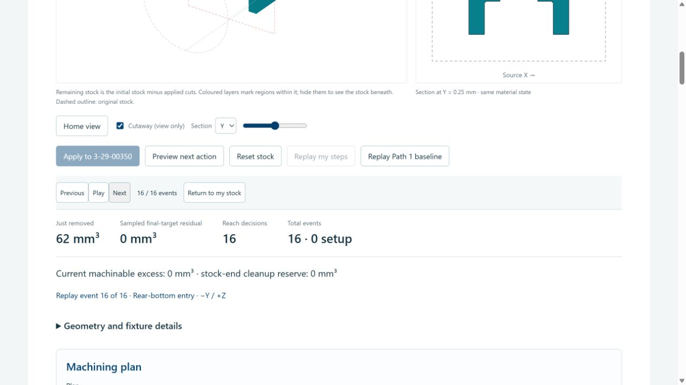](images/industrial-reach/26c-random-replay-complete.jpg)

*Step 6 — Read-only random replay at 16 / 16 events. The displayed replay history does not replace the independent accepted live stock.*

Check **Saved input: 4 complete sequences, 51 recorded decisions, 1 sequence
label, 0 action-kind labels**. Choose **Download training input** into a separate
Run B folder. Its first three episodes and both preference arrays are unchanged
from Run A; the fourth episode is the exact saved random sequence.

[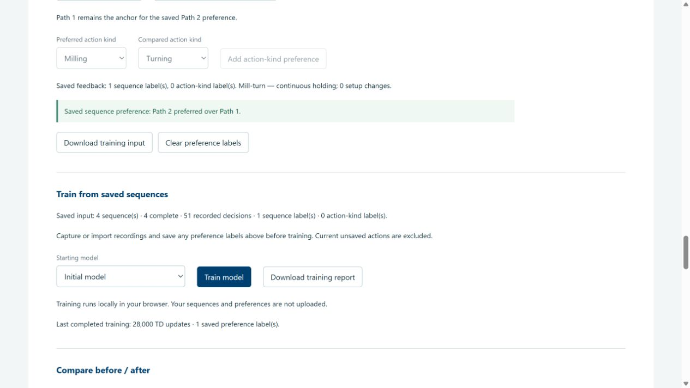](images/industrial-reach/27-random-b-training-input.jpg)

*Step 6 — Run B adds 16 random decisions to the same 35 saved reference decisions. The last completed-training count still describes Run A before the new Train click.*

### 7. Train Run B from the same Initial model

Keep **Starting model → Initial model** again and choose **Train model**. The
same starting checkpoint and configuration are used for both runs. This makes
the saved random episode the input difference; continuing Run A's weights would
change the starting point.

[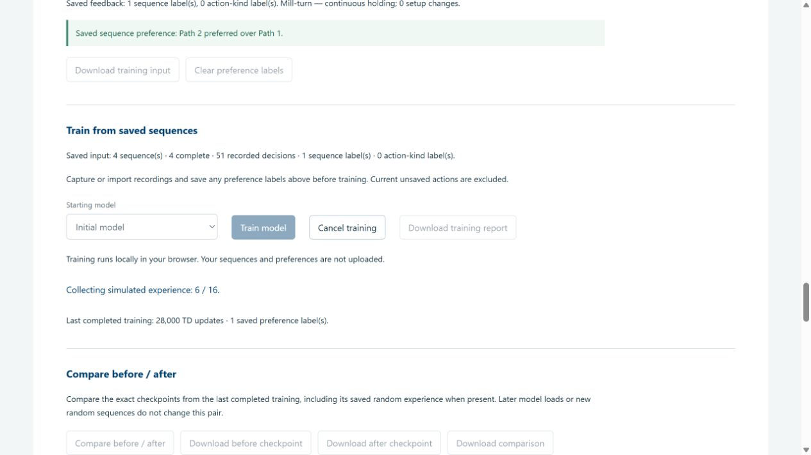](images/industrial-reach/28b-random-b-training-progress.jpg)

*Step 7 — Actual Run B progress: collecting simulated experience 6 / 16. The retained 28,000 count below it belongs to the previously completed Run A.*

Run B completed with **155 simulated cutting transitions**, **31,000 TD
updates** and **1 explicit preference label**. Its configuration remains 200
reward epochs, 200 TD epochs, 12 exploration episodes and seed 350289. The saved
reference/random decisions and the total simulated training transitions are
different counts. Its fitted preference probability is **0.49446 → 0.72787**,
the same fitted pair as Run A.

Retain **Download training report**, **Download loaded checkpoint**, **Download
before checkpoint** and **Download after checkpoint**. The checked browser model
loads automatically. Run B's before-checkpoint download is byte-identical to Run
A's before checkpoint; Run B's loaded-checkpoint download is byte-identical to
its after checkpoint. The raw downloads are linked below with their hashes.

[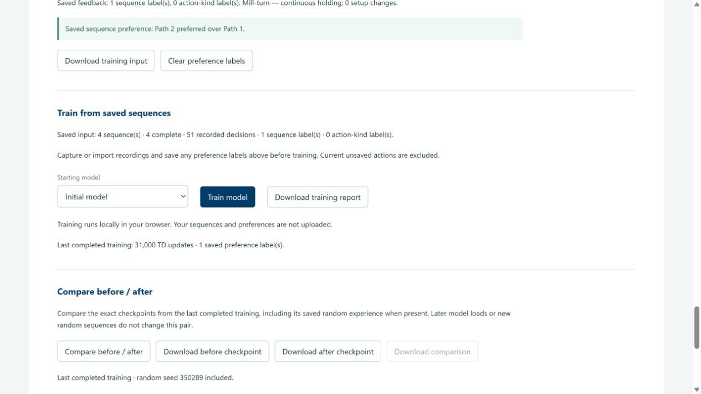](images/industrial-reach/29-random-b-training-complete.jpg)

*Step 7 — Actual Run B completion and its own before/after download pair. The saved random episode belongs to this completed training snapshot.*

### 8. Run inference and inspect identical-state choices

Choose **Run inference and compare** (captioned **Compare before / after** in the dated v10 captures), then **Download comparison** for Run B. Its
six checked full rollouts start from identical original stock: Path 1 **11**,
Greedy **11**, Path 2 **13**, saved random experience **16**, Initial policy
**11**, and trained B policy **24** cuts. Every row is sampled complete with
**0 mm³ residual**. The pair belongs to the last successful training and includes
seed 350289; later model loads or new generation do not replace this pair.

[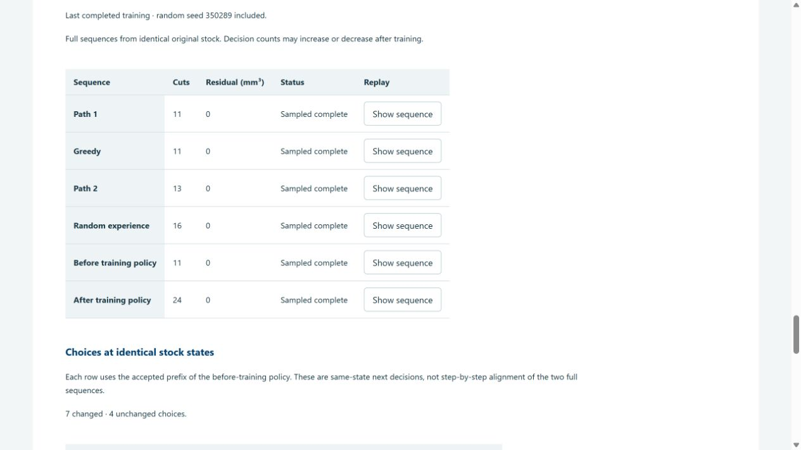](images/industrial-reach/30b-random-b-all-six-rows.jpg)

*Step 8 — Actual built-in Initial → B comparison. This table contains neither control A nor MCTS.*

Under **Choices at identical stock states**, the same accepted prefixes of the
Initial policy are supplied to both models. The Run B view reports **7 changed
and 4 unchanged choices** across 11 states. At original stock the Initial model
chooses outside turning at 40 mm; B chooses facing toward the positive axis at
5 mm. Later unchanged rows remain visible. These probes compare next commands
at the same stock; they do not align two divergent full sequences step by step.

[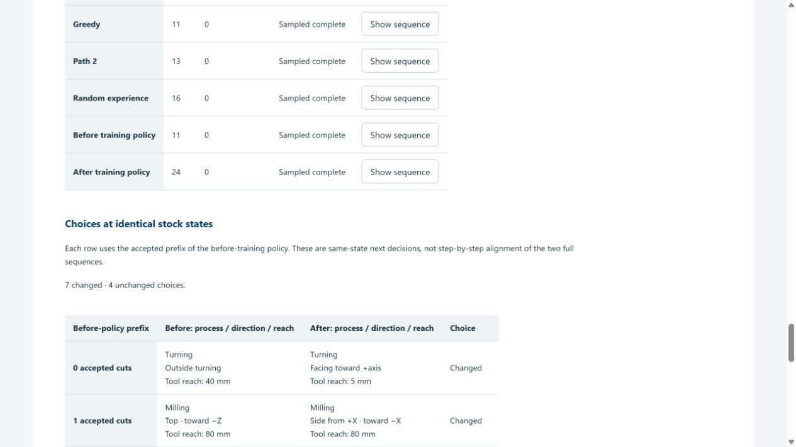](images/industrial-reach/31a-initial-b-same-state-choices.jpg)

*Step 8 — Original-stock policy choices differ in turning mode and reach. This is Initial versus B; a separate controlled A/B comparison isolates the added random episode.*

[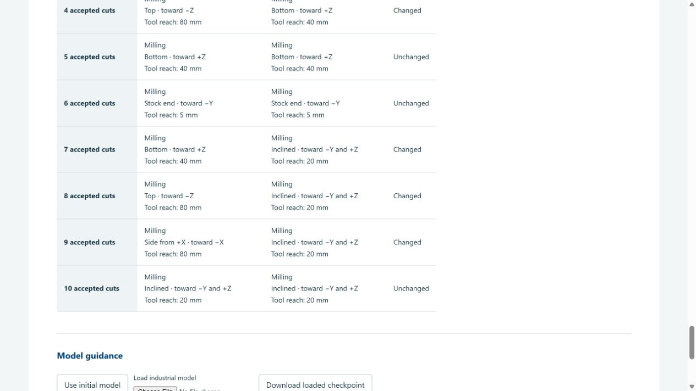](images/industrial-reach/31b-initial-b-same-state-choices-lower.jpg)

*Step 8 — Both changed and unchanged next decisions are retained, including unchanged bottom milling, stock-end cleanup and the final inclined pass.*

Run A and Run B both change seven of these Initial-policy choices, but equal
aggregate counts do not establish identical commands. Assess the added random
experience using the separately retained A/B checkpoints and identical-state
comparison, alongside the complete A/B rollouts. More cuts and changed decisions
are observed behavior, without a machining-efficiency claim.

### 9. Reload exact checkpoints and compare their next policy choice

Reset stock before each model probe. Choose **Use initial model**, then
**Suggest industrial policy**. Load the actual Run A after checkpoint with
**Load industrial model** and confirm **compatible checkpoint**. Repeat with
Run B's downloaded after checkpoint. Loading and suggestions preserve stock;
this recording kept **0 accepted cuts** for these original-stock probes.

[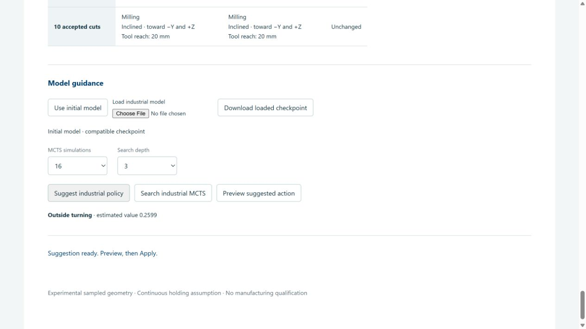](images/industrial-reach/20-initial-policy-original-stock.jpg)

*Step 9 — Initial-model policy suggestion at original stock. A suggestion is separate from an accepted cut.*

[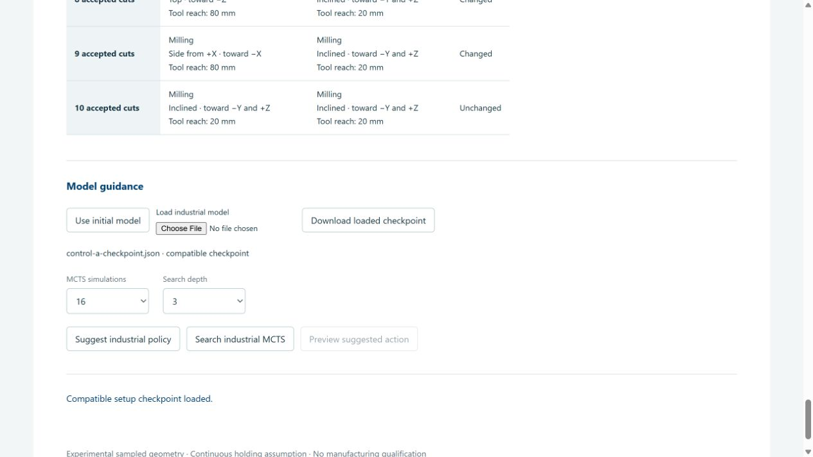](images/industrial-reach/22-control-a-checkpoint-reloaded.jpg)

*Step 9 — Run A checkpoint selected through Load industrial model and acknowledged as compatible.*

[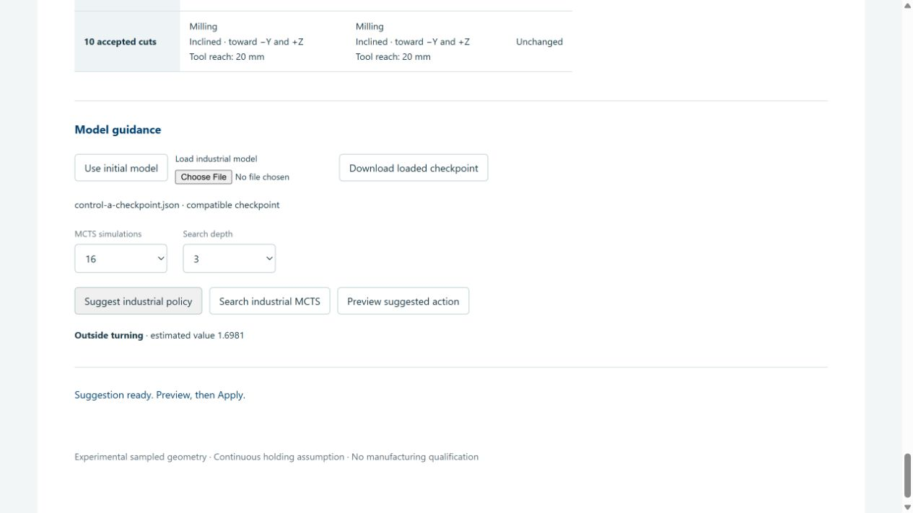](images/industrial-reach/22b-control-a-policy-original-stock.jpg)

*Step 9 — The actual reloaded A checkpoint supplies the policy suggestion. The displayed estimated value is a model score, not machining time.*

[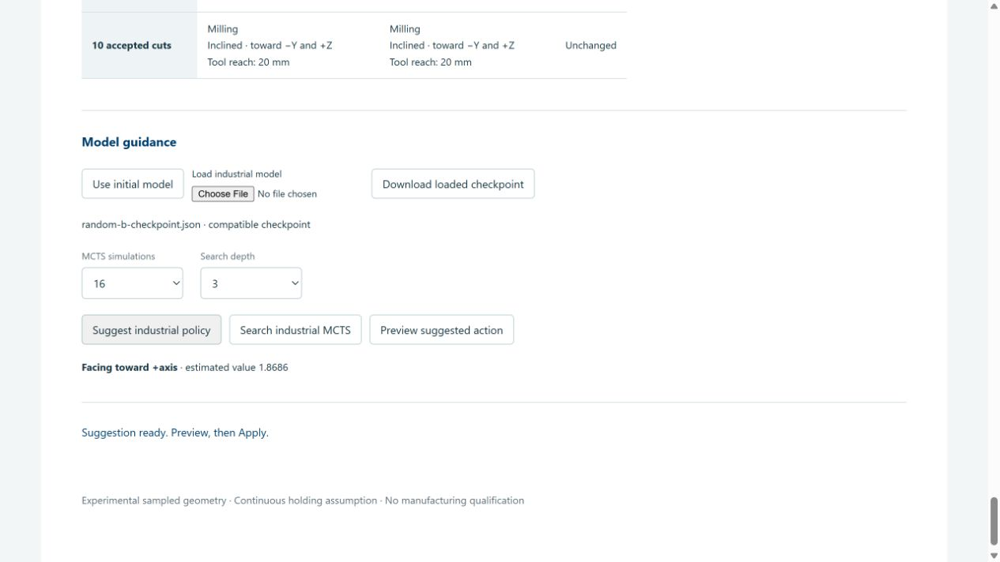](images/industrial-reach/32-random-b-policy-original-stock.jpg)

*Step 9 — The actual reloaded B checkpoint suggests Facing toward +axis at the same original stock.*

Choose **Preview suggested action** to expose process, engagement direction and
reach. The matched original-stock views below show A's **outside turning at
20 mm** and B's **facing toward +axis at 5 mm**. Both have zero accepted cuts.
These are two separate raw captures, and each preview preserves accepted stock.

[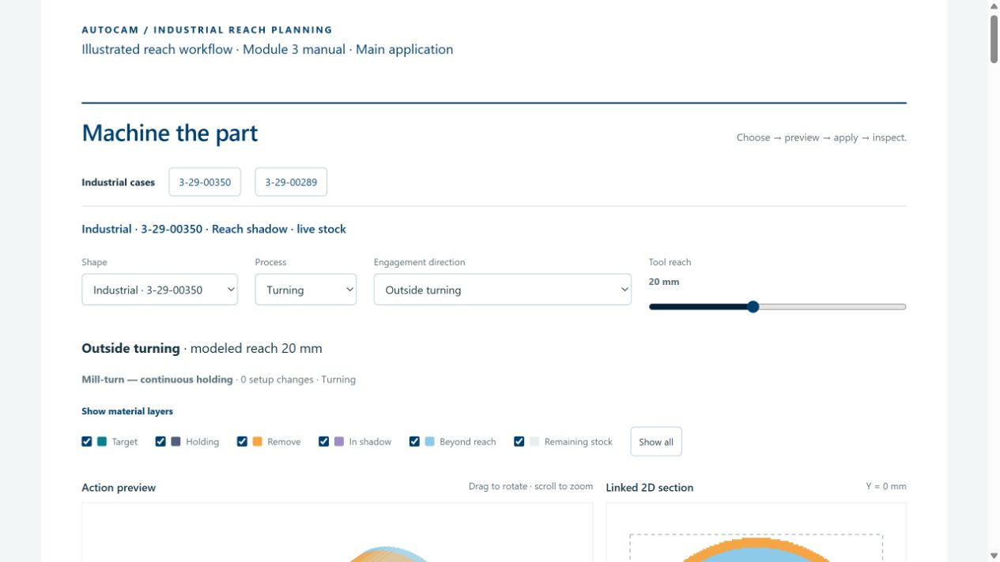](images/industrial-reach/34a-control-a-policy-preview-20mm.jpg)

*Step 9 — Actual A policy preview at original stock: Outside turning, 20 mm. No Apply was performed for this probe.*

[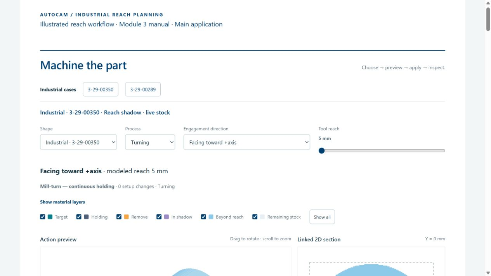](images/industrial-reach/32b-random-b-policy-preview-5mm.jpg)

*Step 9 — Actual B policy preview at the same original stock: Facing toward +axis, 5 mm. No Apply was performed for this probe.*

Choose **Download loaded checkpoint** after reloading B. Its raw bytes match the
original B after-checkpoint download, retaining the trained model through the
file round trip. **Apply** remains a separate explicit decision after inspection.

### 10. Compare MCTS, checked full rollouts and the random effect

Reset stock and load the intended exact checkpoint before each search. Choose
**MCTS simulations → 16** and **Search depth → 3**, then **Search industrial
MCTS**. The recorded comparison uses exploration 1. Search and **Preview
suggested action** preserve accepted stock; Apply remains explicit. These three
live searches inspect the same original stock and empty accepted history.

[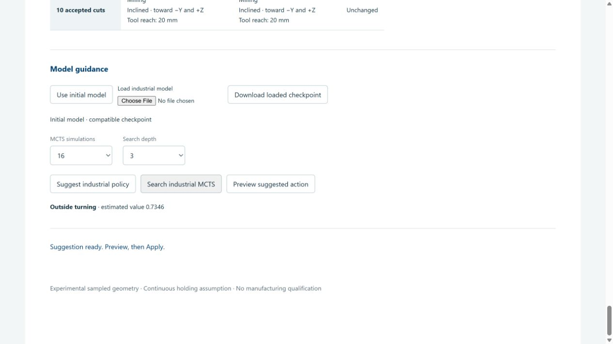](images/industrial-reach/21-initial-mcts-original-stock.jpg)

*Step 10 — Actual Initial-model search with the declared 16/depth-3 budget. This is a first-decision probe, not a complete Initial MCTS rollout.*

[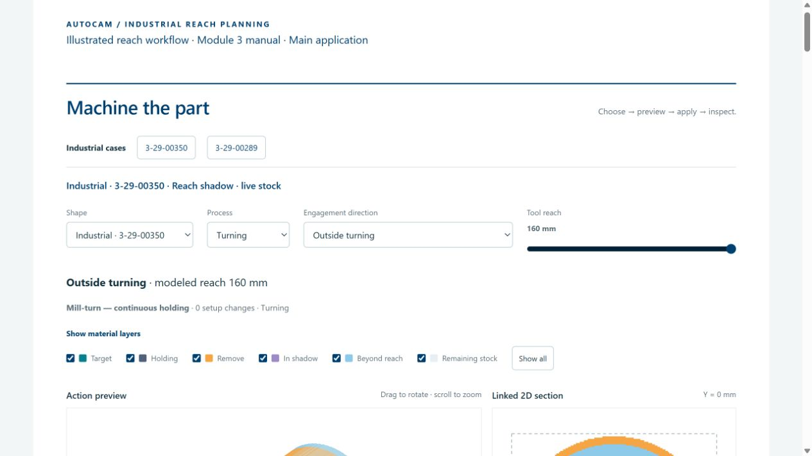](images/industrial-reach/21b-initial-mcts-preview-reach.jpg)

*Step 10 — Preview exposes the Initial MCTS suggestion: outside turning at 160 mm. Accepted cuts remain zero.*

[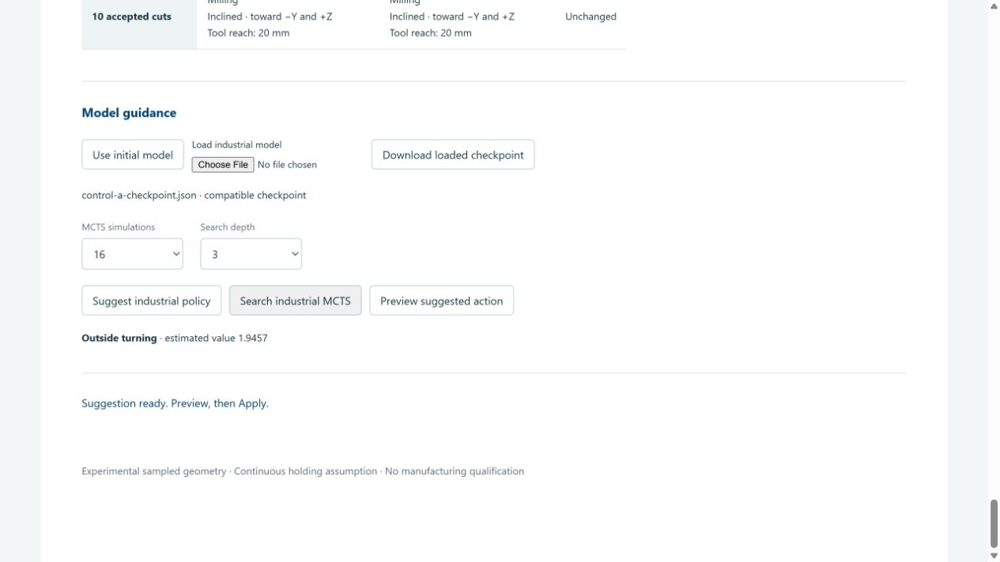](images/industrial-reach/23-control-a-mcts-original-stock.jpg)

*Step 10 — Actual A-model search at the same stock and budget. Its exact checked next command is outside turning at 40 mm.*

[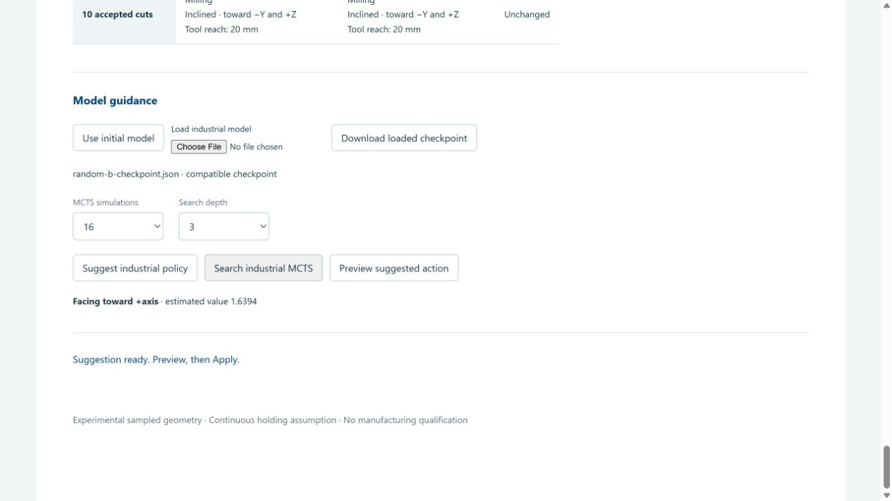](images/industrial-reach/33-random-b-mcts-original-stock.jpg)

*Step 10 — Actual B-model search at the same stock and budget. Its exact checked next command is facing toward +axis at 5 mm.*

For a full policy rollout, the numerical check repeatedly used the exact browser
checkpoint through the same simulator and positive-removal gates. For full B
MCTS it repeated the **16 simulations / depth 3 / exploration 1** search after
each accepted command. These complete numerical episodes were then selected
with **Restore industrial decisions** in the live app. The following captures
show checked restores of **24 policy cuts** and **20 MCTS cuts**; they do not
represent 24 or 20 separate browser Apply clicks. The earlier Path 1 record did
use 11 individual browser Apply clicks.

[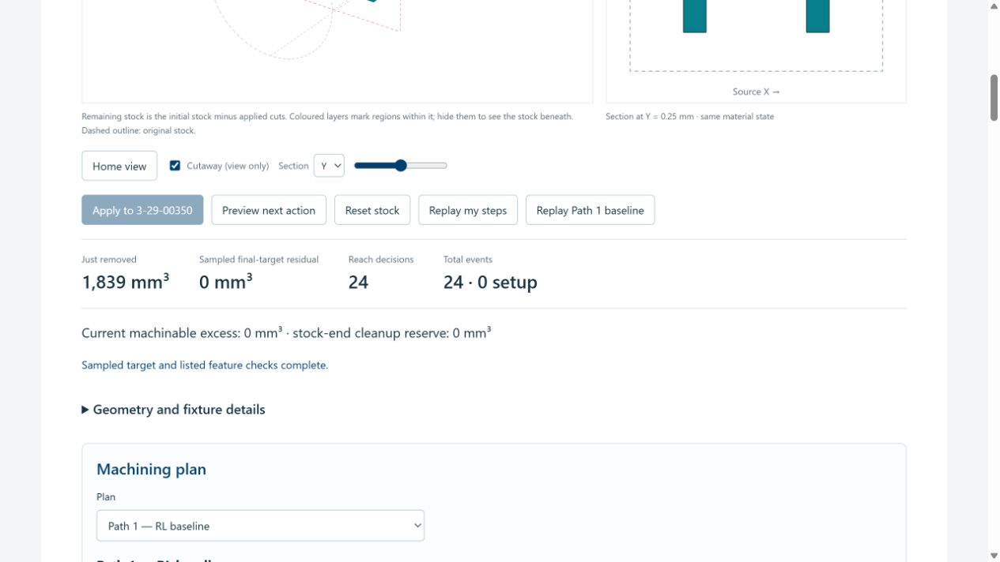](images/industrial-reach/35-random-b-policy-checked-restore-24cuts.jpg)

*Step 10 — Checked B-policy restore: 24 cuts, zero sampled residual and zero setup events. The app accepted the independently generated full episode.*

[](images/industrial-reach/36-random-b-mcts-checked-restore-20cuts.jpg)

*Step 10 — Checked B-MCTS restore: 20 cuts, zero sampled residual and zero setup events. This is separate from the original-stock MCTS suggestion probe.*

[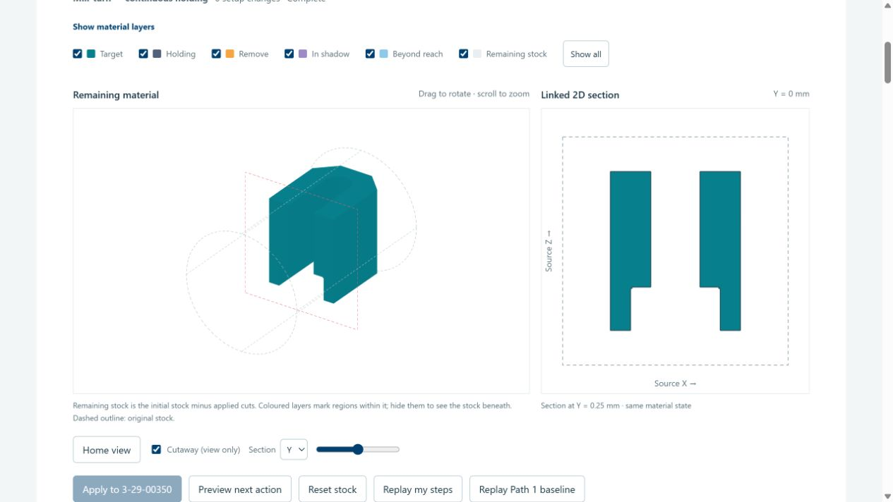](images/industrial-reach/36b-random-b-mcts-complete-material.jpg)

*Step 10 — Material view and linked section after the complete checked B-MCTS restore. The final state satisfies this sampled model and its listed checks.*

#### What changed when random experience was added

The controlled numerical comparison verifies that B minus the exact saved random
episode equals A, including episode order and unchanged preference arrays. Both
trainings use the same Initial checkpoint and configuration. The fitted
preference reward weights are also identical; the added random episode supplies
additional simulated experience without becoming a preferred sequence.

Across identical stock states, A and B differ at **1 of 11 Initial-policy
prefixes** (10 unchanged) and **2 of 20 A-policy prefixes** (18 unchanged). At
original stock, A policy chooses outside turning **20 mm**, while B chooses
facing toward +axis **5 mm**. MCTS chooses outside turning **160 mm** for Initial,
outside turning **40 mm** for A, and facing toward +axis **5 mm** for B at the
same search budget. The complete A/B policies use **20 / 24 cuts**, and complete
B MCTS uses **20**. Only B has a complete repeated-MCTS rollout in this record;
Initial/A MCTS are first-decision probes.

The four captures below are **derived numerical records**, rendered from the
checked actual browser-model comparison. They are not app panels. Their
1280 × 720 viewport captures are retained untouched, with readable tables and
relative links to the portable source records in the guide.

[](images/industrial-reach/37-derived-eight-row-comparison.jpg)

*Derived result — Eight complete rollouts: Path 1, Greedy, Path 2, seeded random, Initial policy, A policy, B policy and B MCTS. Every row has zero sampled residual, zero target loss, 12/12 feature checks, 9/9 positive finishing checks and zero setup changes.*

[](images/industrial-reach/38b-derived-first-policy-top.jpg)

*Derived result — Reference and policy first commands at identical original stock. A and B choose different turning modes and reaches.*

[](images/industrial-reach/39c-derived-first-mcts-confirmed.jpg)

*Derived result — MCTS next commands under the same 16/depth-3/exploration-1 budget: Initial 160 mm, A 40 mm, B facing 5 mm. Initial and A are probes only.*

[](images/industrial-reach/40-derived-random-experience-effect.jpg)

*Derived result — Adding one seed-350289 episode changes selected inference decisions while most checked same-state choices remain unchanged. This is one controlled pair and one seed, without a general improvement claim.*

More cuts, changed choices or higher model scores do not establish better
machining. Stage counts group accepted reach decisions, not physical tool
changes. The declared continuous mill-turn holding assumption produces zero
setup changes; fixture contacts and rotary kinematics are not simulated.

The [recorded downloads and portable numerical pages](../rrv2_module3/guide/index.html#fresh-downloads)
retain the actual browser inputs/outputs, checked numerical episodes and path-free
comparison. Raw file SHA-256 values identify downloaded bytes; canonical model
digests identify parsed model content and are labelled separately. The
[optional Node.js recipe](../rrv2_module3/guide/index.html#node-training) reproduces
training separately; both recorded A/B trainings above used the browser button.
The [00289 case](../index.html?case=industrial_00289#gym) retains its existing
application and greedy baseline.

Completion means zero sampled residual and the listed feature-envelope checks
in the 0.5 mm reach model. It does not establish continuous surface conformance:
the inherited 0.01 mm facing standoff leaves a documented 46.642447547 mm³
continuous remnant below the sampling representation. Physical cutter diameter,
holder clearance, machine motion, CAM path and measured manufacturing efficiency
are outside this model.

<a id="verification-identity"></a>

The initial walkthrough used public source `c602567afb005777315ee6ecdd3696ffafb26dd6`. The Windows training-packaging repair and earlier documentation corrections were subsequently published as source `262c5c9b537b25dcd87cf845a9128f4a2353ab37`; its hosted files and affected workflows were checked separately. Preparation-recovery and physical-tool-label corrections are present in verified published source `f287dbf89865ad0d94453abfe9c88fe8f1d64be7`. Build-record loading and mixed-learning recovery captions were corrected in verified published source `39ce5d725e43bd894ac7071866ee770e1d4aa6cd`. This edition also documents the indexed-restore acknowledgement distinction in source `5e55041b6458c4e9cd6bf34e4cccf9608abc4b12`. Later observations identify their version below; match downloaded run details to the executing release. Detailed execution records are retained separately from this product manual; later checks do not change the original public result.

<a id="scope"></a>

## 1. What Module 3 does

GYM is the interactive environment: load a supported case, inspect material and tools, choose a checked action, apply it, and retain the resulting history. Learning uses compatible recorded decisions or the advertised self-play routes. The resulting model can rank choices or guide bounded MCTS search in its own task family. Knowledge formalization consists of executable input, state, action, tool and model contracts.

| Function | User input → output | Boundary |
| --- | --- | --- |
| Reusable Results V2 — Module 3 | Exact 00350 Reach case + phase-gated decisions and saved feedback → browser-trained model and policy/MCTS suggestions | Separate V2 dataset/model; explicit drilling and finishing; preview and Apply; see the current guide above |
| Original industrial rules, preferences and RL | Two pinned sampled cases + baseline/explicit feedback → learned reward, RL checkpoint and policy/MCTS suggestions | Separate classic 00350/00289 models; mandatory stock/holding/action checks; preview and explicit Apply |
| Other teaching GYM cases | Prepared case + action → changed shared stock, sequence and replay | Sampled geometry and supplied staged baselines; no compatible industrial learner |
| Local STEP | STEP + engine/profile + stock/tool settings → prepared stock, inspection and eligible actions | Import, inspection and machining are separate stages; support depends on the chosen profile |
| Mixed operator learning | Recorded turning/face/drill decisions + starting checkpoint → replay-verified learning and 34-weight checkpoint | Synthetic task; fixed reward; policy/MCTS suggestions require explicit preview and acceptance to execute |
| Task-5/task-6 learning | Family-compatible recorded episode → separate learned checkpoint | Their **Run model** controls execute a checked choice; task-5 and task-6 contracts differ |
| Regional v2/v3 learning | Compatible episode/task context → 48-/50-feature family model | Exact version and prepared context must match |
| Cylindrical v1–v3 learning | Configuration + initial state + model, optionally decisions → learned weights and replay record | Bounded MCTS and explicit Apply; no separate policy button |
| Other model consumers | Compatible task-4, combined or indexed model → supported inference/search | No standalone trainer for these families is promised by this package |
| Knowledge constraints | Exact schemas, state identities and geometric/model checks → accepted operation or stated rejection | No general company-rule authoring, review, qualification or activation service |

The [public workflow catalogue](WORKFLOW_CATALOGUE.md) lists the 24 registry families and the separate V2 workflow. F24 covers both original industrial learning cases. Historical 23-family verification remains scoped to its original release; this manual does not mark every current browser route passed.

<a id="figure-1"></a>


*Figure 1 — Start by reading the workflow capability banner and opening **Supported stages and restrictions**. Select the route that supports the intended stage. The STEP section identifies its supported geometry boundary.*

<a id="figure-2"></a>


*Figure 2 — The public capability matrix separates import, stock preparation, inspection, machining, recording/replay, policy, MCTS and local training. Its legend distinguishes supported, restricted, external and unavailable. Read the selected profile across the row; an available import or inspection stage does not promise every later stage. [Public matrix](CAPABILITIES.md).*

<a id="installation"></a>

## 2. Open the app or install the local trainer

From the published or locally served documentation, open the [application](../index.html) and its **Build identity** link. In a repository preview, use the project's deployment link to open the running site. Record the displayed source revision. A hosted build and an unpublished repair checkout are different versions.

For local installation, enter the current application base URL and the clone URL from the repository's **Code** menu. Use the published source revision and record its identity:

```powershell
$siteUrl = Read-Host 'Base URL of the running application, without query or fragment'
$repositoryUrl = Read-Host 'Clone URL from the repository Code menu'
$releaseUrl = [Uri]::new([Uri]($siteUrl.TrimEnd('/') + '/'), 'release.json')
$publishedRevision = (Invoke-RestMethod -Uri $releaseUrl -ErrorAction Stop).source_repository.revision
if ($publishedRevision -notmatch '^[0-9a-f]{40}$') { throw 'The served release has no valid source revision.' }
git clone -- $repositoryUrl AutoCAM_UI
if ($LASTEXITCODE -ne 0) { throw 'Clone failed.' }
Set-Location -LiteralPath AutoCAM_UI -ErrorAction Stop
git checkout --detach $publishedRevision
if ($LASTEXITCODE -ne 0) { throw 'Published checkout failed; stop here.' }
git rev-parse HEAD
git status --short
node --version
npm --version
npm ci
npm run build:release
```

**Historical reproduction only:** the walkthrough's exact source was `c602567afb005777315ee6ecdd3696ffafb26dd6`. Checking out that fixed revision reproduces the initial observations, including the cylindrical issue; it does not acquire a later repair. The primary recipe above selects the served source. Published `262c5c9` includes the Windows path-length correction described below.

Select an installed **Python 3.12** interpreter as `python` before the next commands; confirm the version. The walkthrough machine default was 3.13, so an installed 3.12 interpreter was explicitly selected. Use a fresh checkout-local environment:

```powershell
python --version
python -m venv .venv
./.venv/Scripts/python.exe -m pip install -r python/requirements.txt
node scripts/python-command.mjs --version
python -m http.server 8080 --bind 127.0.0.1 --directory dist
```

Open `http://127.0.0.1:8080/`; keep the server terminal open. On Linux, the [installation guide](INSTALLATION.md) uses `python3.12` and `.venv/bin/python`. The initial installation passed with Node 24.14.0, npm 11.9.0 and Python 3.12.13. Only declared Python requirements were installed. No Master checkout or custom `PYTHONPATH` was used. The build and local HTTP checks passed.

The release build downloads pinned runtime/CAD dependencies. Classic catalogue data and some runtime requests also need network access. Opening `dist/index.html` directly does not replace serving it over HTTP. Follow the repository [installation guide](INSTALLATION.md) for prerequisites and [validation guide](VALIDATION_GUIDE.md) to reproduce the build checks.

<a id="industrial-workflow"></a>

## 3. Industrial GYM: three actions on shared stock

1. Select **Industrial · 3-29-00350**. Choose **Reset stock** if an earlier sequence exists. Inspect the target, holding material and excess stock.
2. Select **Turning**, **Outside turning**, **40 mm** tool reach; apply the action.
3. Switch **Process** to **Milling** without resetting. Choose **From above (−Z)**, **80 mm** reach; apply.
4. Choose **From below (+Z)**, **40 mm** reach; apply.
5. Select **Replay my steps**. Review the same recorded sequence, then return to live stock. Use **Reset stock** for a new run.

| State | Expected sampled excess | Observed |
| --- | ---: | --- |
| Initial | 388,600 mm³ | Reference start |
| After outside turning | 286,750 mm³ | Recorded browser action |
| After milling −Z | 33,236 mm³ | Recorded browser action |
| After milling +Z | 0 mm³ | Three actions; target and holding material preserved |

<a id="figure-3"></a>


*Figure 3 — The result screen shows **0 mm³ excess**, **3 applied actions** and the turning/milling sequence. The final action removes 33,236 mm³. This demonstrates shared sampled stock; it does not establish a qualified machining plan.*

<a id="figure-4"></a>


*Figure 4 — The linked 3D material and 2D section views show the retained target and holding material after the three cuts. Camera and cutaway controls affect inspection, not accepted stock.*

**Play greedy baseline** demonstrates staged removal: turning first, then milling. It is not trained RL or an optimal plan. View rotation, cutaway and section controls change the display, not the accepted material. An exhausted action must not fabricate further progress. [Guide](GYM_QUICKSTART.md).

<a id="step-input-boundaries"></a>

## 4. Your own STEP: select the supported route first

| Route | Starting example/settings | Supported boundary |
| --- | --- | --- |
| Classic voxel | `core/tests/fixtures/box.step`; pitch 2 mm, stock allowance 2 mm, reaches `2, 4`, spindle Z, negative held end, holding length 2 mm | Sampled stock and turning/milling actions; resolution has a cell budget |
| Classic B-Rep | Same box; OpenCascade B-Rep, deflection 0.2 mm, allowance 5 mm, reaches `5, 10, 20`, spindle Z, negative held end, holding length 5 mm | Supported STEP operations and checked actions; not every imported shape guarantees all operations |
| Adaptive planar | Axis-aligned planar profile; box stock, margin 2.5 mm, allowance 0.5 mm, spindle Z, Coarse depth 4 | Stock/allowance preparation and original-face inspection; machining needs its separate setup/policy |
| Adaptive coaxial or spherical | Exact profile and fixture/setup pairing in the catalogue | Supported coaxial parts or complete principal-frame spheres; not arbitrary curved solids |
| Adaptive rational prism | Exact supported experimental input and settings | Preparation and inspection only; machining unavailable |

<a id="step-workflow"></a>

### Classic STEP screen sequence

Expand **Open your STEP file**, select the engine, choose the file and enter its settings. Select **Prepare shadow gym** and wait for completion. Apply an available turning action, then switch to milling and apply an available milling action. Inspect the persistent history and remaining stock. Replay and reset have the same explicit meanings as the industrial route.

The manual-only browser run used box input on both classic engines. The voxel run retained two actions across the process switch, with 352 mm³ and 256 mm³ removed and 384 mm³ excess remaining. The B-Rep run retained two actions, with approximately 3,689.8 mm³ and 274.952 mm³ removed and 48.805 mm³ excess remaining. These are different representations and settings, not equivalent accuracy claims.

<a id="figure-5"></a>


*Figure 5 — B-Rep setup for `box.step`: display deflection 0.2 mm, stock allowance 5 mm, reaches 5/10/20 mm, spindle Z, negative held end and holding length 5 mm. Set these before **Prepare shadow gym**.*

<a id="figure-6"></a>


*Figure 6 — The B-Rep case retains two 10 mm-reach actions across the process switch: turning removes approximately 3,689.8 mm³ and milling 274.952 mm³. The remaining 48.805 mm³ is still excess; this screen does not claim completion.*

<a id="step-replay"></a>

Select **Replay my steps**, then **Previous**, **Play** or **Next** to inspect recorded states. Select **Return to my stock** to leave replay and resume the live accepted state. Keep **Download actions** and **Download original STEP** together for local reproduction.

<a id="figure-7"></a>


*Figure 7 — Replay is at **1 / 2**: it shows the turning step's **3,689.8 mm³ removed**, **323.757 mm³ excess** and one applied action at that historical point. Both saved history entries remain listed. This is inspection of a recorded state, not another committed cut. **Return to my stock** returns to the live two-action state.*

<a id="failure-recovery"></a>

### Failure recovery is part of the workflow

After a valid case exists, try the guide's rejection examples. `broken.step` containing `not a STEP model` must fail import. Box pitch `0.01` must reject the excessive grid. Cancel a preparation and retain the previous accepted stock. Do not interpret an error as a new valid empty case.

The browser record shows **1,680,000,000 cells; limit 300,000** for the tiny-pitch attempt, while the prior two-action stock remains visible. Malformed-input and cancellation observations also retain that prior case.

For a live GYM calculation, **Cancel computation** stops pending work. Use the offered recovery control and wait for the ready state. Cancellation does not undo a command that the simulator has already acknowledged. In the indexed GYM, **Recording restored; refreshing accepted state…** means the recording is already accepted while its material view is being refreshed. Cancel at that point and **Restore last completed state** recovers that restored recording. Cancel before the restore is acknowledged and recovery retains the previous acknowledged state. After recovery, verify the ready state and retain matching **Download decisions** and **Download run details** files; the older image shown during a pending refresh does not establish the latest acknowledged head.

<a id="figure-8"></a>


*Figure 8 — A separate B-Rep malformed-input attempt reports **OpenCascade could not read the STEP input** in the preparation form. This screenshot shows the error, not the earlier history in the same frame. Prior-state retention must be assessed from the corresponding state record.*

<a id="adaptive-stock-faces"></a>

### Adaptive stock and original faces

Expand **Prepare stock from your STEP file**. Choose the supported profile, stock shape, margin, allowance, spindle direction and partition detail, then **Prepare STEP stock**. Retain **Download initial stock**, **Download target certificate** and **Download stock proposal**. Open **Original faces and import record** and inspect its exact record.

The tested planar allowance example produced stock bounds **15 × 13 × 11 mm**, allowance **0.5 mm**, **2,976 partition cells** and **6 original faces**. Its message explicitly says boundary uncertainty remains. Face provenance records the imported source and frame; `machining_features_assigned` and `contact_assessed` are false. Face inspection therefore does not imply recognized machining features or qualified contact.

<a id="figure-9"></a>


*Figure 9 — The completed preparation/inspection screen reports **2,976 partition cells**, continuing boundary uncertainty, **6 original faces** and **OpenCascade 7.8.1**. The import record and stock-stage downloads are available, while machining setup is a separate next stage. Original faces are not automatically machining features or proof of tool access. This demonstrates preparation and inspection only; it does not close planar machining.*

At the initial walkthrough cutoff, the saved planar machining receipt still said **Preparing source-derived machining candidates**, so that attempt was not counted as completed machining. The [dated functional checks](#followup-20261021) record a later completed, separately configured planar case. Figure 9 remains evidence of its original preparation/inspection case. Other routes are claimed only to the extent of their stated browser observations; native fixture results alone do not close an unobserved UI check.

For the [prepared cylindrical-choice workflow](WORKFLOW_CATALOGUE.md#cylindrical-choice), select the physical tool by both its profile and exact ID: **Ball end mill (BALL_END-long)** and **Flat end mill (FLAT_END-long)** are different tools even when both show 20 mm reach. The picker and dependency comparisons use the same descriptions. Preview the intended choice and read its actual result before applying; a descriptive label is not an acceptance result.

In the [task-5 remaining-stock workflow](RECORDED_TRAINING_QUICKSTART.md), the adaptive Tool picker also shows exact IDs and flute lengths: **long-flute** has a 20 mm flute and **short-flute** a 4 mm flute, while both have 20 mm usable reach. Select the intended tool by ID and flute length; reach alone does not describe its cutting length or shank clearance.

<a id="operator-learning"></a>

## 5. Industrial feedback → local RL → browser model use

<a id="industrial-learning"></a>

### Original root workflow: two industrial cases

This section covers the classic root application. The current V2 browser-training
example and its recorded A/B comparison appear [above](#industrial-reach-workflow).

Use **3-29-00350** and **3-29-00289**, the catalogue-based working choice for the
second case. Begin with the [industrial learning quickstart](INDUSTRIAL_LEARNING_QUICKSTART.md).
It gives exact input pins, browser steps, local commands and recovery. The
synthetic learning example remains below with its existing fixed objective.

| Stage | What you do | What it means |
| --- | --- | --- |
| Rule baseline | Generate a sequence from initial stock, one accepted action at a time | Productive turning before milling; greatest sampled removal; shorter reach/action-ID ties; each decision retains its state and reason |
| Demonstration | Apply your own eligible sequence, or retain a complete alternative | Supplies replayable simulator experience; no preference label is inferred |
| Whole-sequence preference | Compare two complete replayed sequences and state which you prefer | Labels those exact alternatives; it does not declare every constituent action generally best |
| Action-kind preference | Prefer turning or milling where both have eligible alternatives | Case/state-scoped soft preference; hard action, holding, target and stock checks still apply |
| Local learning | Download feedback; run the Node.js trainer in a new output directory | Pairwise logistic reward fitting, then TD Q fine-tuning on demonstrations and simulator exploration |
| Model use | Load the matching case checkpoint; compare policy and bounded MCTS | Suggestions do not accept cuts. Preview and existing Apply remain separate |

The baseline heuristics are software rules derived from the staged geometric
comparator; they are not company-qualified manufacturing knowledge. Action-kind
labels are checked at their recorded anchors; shared case coefficients may
affect other states of the same case. Reward
learning starts from normalized sampled removal and fits bounded preference
terms. RL adjusts action values under that learned reward. MCTS then searches
using the same simulator and model; search does not train the weights.

The [industrial guide](INDUSTRIAL_LEARNING_QUICKSTART.md#industrial-local-training)
contains PowerShell and Linux commands. Successful local output retains
`feedback.json`, `initial-checkpoint.json`, `checkpoint.json` and
`training-report.json`. Load 00350 results only into 00350 and 00289 results only
into 00289. A wrong-case or malformed model must preserve the previous model
and accepted stock/history.

Compare baseline, initial model, fine-tuned model and model-guided MCTS from the
same accepted stock under stated budgets for each case. Look for actual action
or sequence changes alongside unchanged recommendations. Changed weights alone
are not a behavioral effect or an improvement. No measured machining-time,
surface-finish, tool-life or cross-case quality conclusion follows.

<a id="industrial-learning-results"></a>

#### Reproducible two-case comparison

The [selected industrial examples](../examples/industrial-learning/README.md#recorded-example-comparison)
use explicit scripted labels: prefer the rule baseline and Turning over Milling
at initial stock. They use the seven-feature version 2 model and default
200/200 learning epochs. These labels are not human feedback. The actual
UI-download/training walkthrough has separate feedback and model identities.

Every sequence below completes with **0 mm³ sampled excess**. Each case's
sequences are evaluated under its **same fine-tuned reward**, discount 0.95;
returns are rounded to six decimals. Separately fitted cases do not share a
physical-quality scale.

| Sequence | 00350 actions | 00350 learned return | 00289 actions | 00289 learned return |
| --- | ---: | ---: | ---: | ---: |
| Rule baseline | 3 | 1.925897 | 3 | 4.368131 |
| Initial policy | 2 | 0.947194 | 3 | 0.900728 |
| Fine-tuned policy | 3 | 1.925897 | 3 | 4.369007 |
| Fine-tuned MCTS | 8 | 1.924920 | 6 | 4.368860 |

The full comparisons also retain the complete alternative, initial-model MCTS,
all action identities and per-search budgets. MCTS uses **16 simulations, depth
2, exploration 1** for each requested action. At initial stock it expands only
**4 of 136 eligible root actions**. In 00350 its eight-action sequence scores
below the three-action rule baseline; in 00289 its six-action sequence scores
below the three-action fine-tuned policy. Bounded MCTS does not guarantee a
better plan or a shorter sequence.

Both initial policies and matched-experience TD without preference fitting
choose milling first. Combined feedback changes the policy to **outside turning,
40 mm** in 00350 and **outside turning, 20 mm** in 00289. Both comparisons record
an actual choice change against matched no-feedback TD. Recommendations remain
unchanged after baseline prefixes of **one and two actions in 00350**, and
**two actions in 00289**. Other labels or configurations can leave recommendations
unchanged; the numerical contract records the single-channel limitation.

The [verification status](VERIFICATION_STATUS.md) keeps this new route separate
from historical three-cut, synthetic and platform results.

<a id="industrial-browser-walkthrough"></a>

For the current 00350 reach/random-experience workflow, go to the
[recorded walkthrough](#industrial-reach-workflow) or its
[detailed illustrated guide](../rrv2_module3/guide/index.html#fresh-recording).
This older section covers the separate earlier three-cut sampled dataset.


#### Actual browser feedback, training and first Apply

The [two-case browser receipt](verification/industrial-learning/README.md)
records a passing Windows/Edge run against its pinned development build and
source bytes. In each case the test accepted a complete alternative through the
normal controls, entered explicit illustrative labels, downloaded actual
feedback, trained locally, loaded that new model, compared policy/MCTS,
previewed and explicitly applied one suggested action. No page errors occurred.
Cancelled search and failed model import preserved accepted state and model;
target and holding stock remained protected.

The full sequence comparisons above use the same shared simulator. The final
image for each case shows **one explicit suggested Apply**, not completion of
the whole plan. The training images show a **local projection of the saved
Node.js report**, distinct from application UI. This automated walkthrough is
not independent human acceptance. Its development build hash does not identify
the later final production build.

##### 00350: from baseline to accepted suggestion


*00350 — Generate rule baseline lists outside turning at 40 mm, milling −Z at
80 mm, then milling +Z at 40 mm. Its predicted residuals are 286,750 → 33,236 →
0 mm³. Generating this replayable sequence leaves accepted stock unchanged.*


*00350 — A complete two-action alternative is retained. The test explicitly
selects Rule baseline and Turning over Milling, saving one label of each kind.
The action-kind label is anchored at the zero-action accepted prefix in this
case. Download industrial feedback exports those labels and exact episodes.*


*00350 — This local report projection shows a passed training run, 20 stored
experience transitions, 4,000 TD updates and an actual feedback choice change
against matched-experience no-feedback TD. It is not an application training
screen. The receipt retains the exact downloaded feedback and checkpoint hashes.*


*00350 — Load industrial model accepts the newly trained checkpoint as compatible.
Loading it does not apply a cut. The same case's initial model remains available
for a comparison at the same accepted stock.*


*00350 — Search industrial MCTS suggests outside turning at 40 mm and reports
16/16 simulations, depth 2/2 and 4/136 root actions explored. The displayed
1.9029 is a backed-up search estimate, distinct from the full-sequence return
in the comparison table. Preview suggested action remains a separate step.*


*00350 — After preview and explicit Apply, the normal stock controls show one
accepted action, 101,850 mm³ just removed and 286,750 mm³ excess remaining.
The linked 3D/2D views show this first accepted result. Further productive
milling is needed; this frame does not show a completed plan.*

##### 00289: separate feedback and separate model


*00289 — The rule baseline uses outside turning at 20 mm, milling −Y at 40 mm,
then milling +Y at 20 mm. Its residuals are 1,062 → 188 → 0 mm³. The state and
reason attached to each decision belong to this case.*


*00289 — A complete three-action alternative is retained. Rule baseline and
Turning over Milling are explicitly labeled at this case's initial prefix.
One whole-sequence label and one action-kind label are saved; the 00350 feedback
and model cannot be substituted for them.*


*00289 — The saved local report projection shows 25 experience transitions,
5,000 TD updates and an actual feedback choice change. The labels were entered
by the automated scenario; they are not independent human feedback.*


*00289 — Its own newly trained checkpoint loads as compatible before any
suggested action is accepted. Use initial model, policy suggestion and MCTS
allow a same-stock comparison with this exact case's model.*


*00289 — MCTS suggests outside turning at 20 mm. The frame reports 16/16
simulations, depth 2/2, 4/136 root actions explored and a 4.3658 backed-up
estimate. Search has only suggested the choice; its finite budget does not
compare every eligible root action.*


*00289 — The first previewed and explicitly applied turning action removes
21,265 mm³, leaving 1,062 mm³ excess and one accepted action. Target and holding
material remain protected. The remaining sequence and zero-residual outcome
are recorded separately in the complete simulator comparisons.*

### Synthetic recording and fixed-reward training

<a id="training-overview"></a>

### Read this first: what does training mean here?

**For the synthetic mixed route below, you choose the demonstrated actions. Fixed geometric and tool checks determine which actions are available. Its fixed reward determines what the learner scores as useful.** These are three separate parts of the system.

The learning route described here is **Synthetic learning gym: turning, face milling and drilling; local weights and recorded actions**. It uses a small linear action-value model with **34 learned weights**. The model scores available actions for the current state. The industrial cases use the separate preference-learning route above; they do not use this synthetic trainer or checkpoint.

<a id="rules-and-learning"></a>

| Part | Who or what controls it? | What happens in this release? |
| --- | --- | --- |
| Allowed actions and constraints | Existing geometric/tool checks and the selected task | Check the available tool, stock, setup and action. The learned model cannot override an unavailable action. |
| Demonstration | You | Choose among the exposed checked actions: tool, turning radius, facing stepover, workpiece index and operation order where offered. Accepted choices and their outcomes form the recording. |
| Learning objective | The existing task's fixed reward | Score progress toward the constructed face/hole requirements and completion; charge synthetic time and apply repeat, no-op and excess penalties. Recording a choice does not change this reward. |
| Training | Local Python trainer | Replay and verify the recording, then adjust the model's weights using the recorded rewards and estimated future action values. |
| Policy suggestion | Loaded model | Score the currently available actions and suggest one. |
| MCTS suggestion | Search using the simulator and loaded model | Explore a bounded set of possible next actions and suggest one. In this mixed-learning UI, suggestions require your explicit Preview/Accept to execute. |

**Accepting actions in the browser records training data. It does not train or update the model. Running the Python training command creates the updated checkpoint.** You then load that checkpoint back into the browser.

<a id="choosing-preferred-solution"></a>

### Can I teach the solution I prefer?

**In this synthetic mixed route you can demonstrate a preferred available sequence, but its trainer has no “prefer solution A over B” label.** The industrial route above has explicit sequence and action-kind labels. The recording supplies the chosen actions and their outcomes. The learner updates action values under its existing reward; it does not simply copy the operator or treat every demonstrated choice as best.

You can choose a different exposed tool, action order, turning radius or facing stepover when the task offers it. You cannot use this workflow to teach a new geometric rule, authorize a blocked action, supply a new unexposed toolpath, or select a new learning objective such as surface finish or tool life. Those preferences are not represented by a user preference setting in this synthetic trainer. No free-text preference or good/bad solution label is consumed.

For example, the supplied demonstrations use the same task and starting model:

| Your chosen demonstration | Facing stepover | Synthetic facing cost | Synthetic whole-sequence cost |
| --- | --- | --- | --- |
| A | 9 mm | 65.4 s | 161.6 s |
| B | 4 mm | 132 s | 228.4 s |

Both complete the constructed requirements. Choosing B records the 4 mm choice; it does not tell the learner that a smaller stepover is preferable or should outweigh time. The model has no measured surface-quality objective in this example. The fixed reward still charges B's longer simulated time. These are synthetic costs, not measured machining times.

**A demonstration is not a guarantee of imitation or improvement.** Both A and B changed 28 of 34 weights, yet the tested starting/A/B models produced the same suggestions at the two comparison states. At the common before-facing state they all selected the 4 mm action. See the [actual A/B results](../examples/operator-input/README.md).

<a id="training-steps"></a>

### Training in five steps

1. **Record in the browser:** open the synthetic learning case; choose, preview and accept checked actions. Use your chosen valid sequence. See [the six-step example](#record-decisions).
2. **Download the data:** select **Download learning decisions**. Keep that actual file; it is an episode, not a trained model.
3. **Train in local Python:** run [the command below](#replay-and-training) with your downloaded episode and the compatible starting checkpoint. A successful run produces a new `checkpoint.json` and replay/training reports.
4. **Load the result:** reset the same compatible case, select **Load local model** (accessible name: **Load learning model**), and choose `runs/operator-new-01/checkpoint.json` from your checkout, or `checkpoint.json` in your chosen output folder. See [load and use](#load-and-use-model).
5. **Evaluate before accepting:** request policy/MCTS suggestions at the same state and compare completion, synthetic cost and chosen actions. Preview and explicitly accept to execute. Changed weights alone do not demonstrate better decisions.

For a controlled A/B comparison, keep the task, starting stock, starting checkpoint and training recipe the same; change only the demonstrated choice. This route verifies a learning workflow for its compatible task. It does not automatically train a policy for a new uploaded industrial part. Other supported training families use [their own commands and compatible inputs](#validation-examples).

<a id="record-decisions"></a>

### Record a new six-step example

Under **Run the adaptive shadow gym**, select **Synthetic learning gym: turning, face milling and drilling; local weights and recorded actions**, then **Open case**. For each choice, use **Preview checked action**, inspect the preview, and explicitly **Accept checked action**. Preview alone must not change stock.

Opening the case may restore a previous browser save. Before starting example A below, select **Reset to initial stock** and wait until the ready screen shows **Step 0 / 6 · 0 s**. Start the six-step recording from that initial state.

Choose example A if you want to demonstrate the supplied sequence with the shorter synthetic time. Follow these six choices in order. For every row, select the choice, preview it, inspect the result, then explicitly accept it. Wait for each computation to finish before continuing.

| Step | Choice to demonstrate | What to check before continuing |
| --- | --- | --- |
| 1 | Turn to **13.5 mm radius**. | The checked turning action is accepted. |
| 2 | Transfer to the **15 mm face tool**. | The face tool is mounted. |
| 3 | Index the workpiece to **180°**. | The accepted index is 180°. |
| 4 | Face mill with **9 mm stepover**. | The facing choice shows **65.4 s** synthetic cost. |
| 5 | Exchange to the **long drill**. | The mounted tool is **mixed-drill-long**. |
| 6 | Select the available drilling action and accept it. | The case reaches **Step 6 / 6**, **COMPLETE**, and **161.6 s** total synthetic cost. |

To demonstrate example B instead, reset to the initial stock and repeat the sequence using **4 mm stepover** at step 4. Its facing cost is **132 s** and total cost is **228.4 s**. Download each recording separately and train each from the same starting checkpoint into a separate output folder. These are two demonstrations under the same fixed reward; choosing B does not create a preference label or a surface-quality objective.

At the end select **Download learning decisions** and **Download run details**. Keep the exact files. The decisions schema is `adaptive-mixed-learning-episode-1`; the paired run details retain software/input identities.

The actual new browser sequence reached **Step 6 / 6**, **161.6 s**, with the long drill mounted. Decisions and run details were downloaded from this state. [Matching supplied A decisions](../examples/operator-input/operator-A.json).

<a id="recording-restoration"></a>

After training and model checks, select **Restore learning decisions** and choose the actual downloaded recording. Wait for reconstruction to finish before interpreting the result. The observed restoration reproduced the completed six-step sequence and **161.6 s** elapsed cost.

<a id="figure-10"></a>


*Figure 10 — **Restoring the actual downloaded recording** reproduced **Step 6 / 6 · 161.6 s · mixed-drill-long** and **Episode ended: COMPLETE**. The download controls remain available. This image captures successful restoration after the training/model checks; it is not a screenshot of the initial recording session.*

<a id="figure-11"></a>


*Figure 11 — The public training guide separates browser recording/model use from local Python training. Choose the guide for the episode's family before running a trainer. This screenshot illustrates the instructions; the actual new recording and model use are illustrated in this section.*

<a id="replay-and-training"></a>

### Train the actual downloaded file

From the repository root, after installing the fresh Python environment, substitute the downloaded filename and choose a new output directory. If you are serving the app locally, leave the server terminal running and open a second PowerShell terminal at the repository root for training. Use the same training options as the walkthrough:

```powershell
$episode = Read-Host 'Full path to your downloaded decisions JSON'
$model = './examples/operator-input/starting-checkpoint.json'
$episodeHash = (Get-FileHash -LiteralPath $episode -Algorithm SHA256).Hash.ToLower()
$modelHash = (Get-FileHash -LiteralPath $model -Algorithm SHA256).Hash.ToLower()
./.venv/Scripts/python.exe python/train_operator_episode.py --episode $episode --expected-sha256 $episodeHash --initial-checkpoint $model --checkpoint-sha256 $modelHash --output ./runs/operator-new-01
```

When prompted, enter the actual absolute or checkout-relative path of your downloaded decisions file. Never reuse a run directory: the trainer rejects overwriting it.

For the command above, the model you will load is **`runs/operator-new-01/checkpoint.json`**, relative to your repository checkout. If you change `--output`, load `checkpoint.json` from that new folder. Keep the downloaded decisions file as the recording; use the newly produced checkpoint as the model.

The launcher verifies exact input bytes, reconstructs the episode, checks replay and applies the published fixed TD-Q update: learning rate **0.05**, discount **1**, error clip **1**. The supplied checkpoint has 34 weights. Demonstrated choices provide the operator input; this is not free-text intent learning.

<a id="measured-training-results"></a>

| New recording result | Observed |
| --- | --- |
| Runtime | 189.33 seconds |
| Replay | Verified |
| Updates | 6 |
| Changed weights | 28 of 34 |
| Download SHA-256 | `2b250ff9d4b1f7705482d9c7a86865d8f5e4a87c69542edba5e09548d92fc092` |
| New checkpoint SHA-256 | `f8048a9f5c51a993c5cbfe65ac02776693e388397fbe95f2113397c9dcaa0f22` |

The actual new download happens to match supplied A bytes exactly; the trained checkpoint also matches its reference. The input was the newly downloaded file, not a substituted fixture. The run retains episode, starting checkpoint, recipe, source snapshot, execution environment, learned checkpoint, training report, summary and file inventories. [Matching reference checkpoint](../examples/operator-input/trained-A/checkpoint.json).

<a id="load-and-use-model"></a>

### Load and request a suggestion

Use **Reset to initial stock** in the same synthetic mixed-learning case. Select **Load local model** (accessible name: **Load learning model**) and choose the new `runs/operator-new-01/checkpoint.json`. Wait until the screen confirms **Compatible model loaded** and the controls are ready. Choose **16 simulations**, **depth 2**, **exploration 1** for the published comparison; request **Suggest with policy** or **Search with MCTS**. A suggestion does not execute a cut: the initial state should still show **Step 0 / 6 · 0 s**. Inspect the selected suggestion with **Preview checked action**, then use **Accept checked action** to execute it. Continue with checked actions and compare the resulting completion and synthetic cost; do not assume that the loaded model will reproduce your demonstrated sequence.

The saved browser sequence shows the new checkpoint loading followed by ready model controls.

<a id="figure-12"></a>


*Figure 12 — The checkpoint produced from the actual new recording (`f8048a9f…aa0f22`) is reimported into the hosted application. The screen confirms **Compatible model loaded**, **Step 0 / 6 · 0 s**, and search settings **16 / 2 / 1**. Loading the model has not accepted a machining action.*

<a id="figure-13"></a>


*Figure 13 — Selecting **Suggest with policy** completes successfully and selects **Turning · turning-blade-long · 20 mm reach · 0° · 10.5 s**. The message says **Policy suggestion ready. Preview and accept the selected action to apply it.** The screen remains at **Step 0 / 6 · 0 s**: the suggestion has not committed a cut. This completes the observed new-recording → local training → model reload → policy-suggestion sequence.*

The new-model MCTS request subsequently completed with **16 simulations**, **depth 2** and **exploration 1**, selecting a **10.25 s turning action** while the stock remained at Step 0. This completes the observed bounded-search step for the newly trained checkpoint.

<a id="figure-14"></a>


*Figure 14 — The screen reports **MCTS used 16 simulations. Preview and accept the selected action to apply it.** The selected action is **Turning · turning-blade-long · 20 mm reach · 0° · 10.25 s**. Step 0 / 6 and 0 s remain unchanged: search suggests a choice and does not commit the cut.*

Reference A/B learning changes weights, but the published starting/A/B models select the same actions at the two comparison states. Initial policy selects action 0; initial MCTS selects action 1; both select action 8 before facing. Changed weights alone are not evidence of better policy quality. [Mixed guide](OPERATOR_INPUT_QUICKSTART.md).

<a id="validation-examples"></a>

## 6. Other training families and repository examples

Choose the guide matching the task. A filename or weight-array length cannot establish compatibility.

| Recipe followed in the fresh clone | Actual local outcome | Source guide/example |
| --- | --- | --- |
| Mixed supplied A/B | Both passed; 6 updates and 28 changed weights; checkpoint/training bytes match references | [Operator examples](../examples/operator-input/README.md) |
| Task-5/task-6 manual recordings | Both passed; 2 updates and 2 skipped decisions each | [Recorded training](RECORDED_TRAINING_QUICKSTART.md) |
| Task-5/task-6 model-MCTS recordings | Both passed; 1 update each; reference outputs match | [Recorded examples](../examples/recorded-training/README.md) |
| Regional v2/v3 | Both passed; 3 updates each; 41/43 changed weights; reference outputs match | [Regional guide](REGIONAL_TRAINING_QUICKSTART.md) |
| Cylindrical v1 recorded | Passed; 3 samples, replay and input custody verified | [Cylindrical examples](../examples/cylindrical-policy/README.md) |
| Cylindrical all-profile command | Initial Windows path-length failure; repaired candidate passed 5 training cases, 4 learned-model searches and 7 rejection checks | [Cylindrical example and verification recipe](../examples/cylindrical-policy/README.md) |

<a id="figure-15"></a>


*Figure 15 — The public examples index exposes inputs and expected outcomes for industrial, mixed, recorded, regional and cylindrical workflows. Choose the example matching the task family, then compare actual outputs with its stated reference. A listed example is a reproducibility entry point, not proof that every UI route was executed in this session.*

The public cylindrical acquisition/verification recipe is:

```powershell
./.venv/Scripts/python.exe python/verify_cylindrical_examples.py --output ./runs/cylindrical-verification-01
```

On the original deep Windows checkout, retaining one producer file created a 261-character path and failed before self-play. The focused repair changes filesystem path handling, not learning or geometry. Its regression failed before and passed afterward; six source/output boundary tests passed. Repeating the documented command with a fresh output name produced a 264-character equivalent path and passed, including v2/v3 models. This correction is included in published `262c5c9`; the original failed run remains a historical observation.

Public fixture acquisition also passed:

```text
node scripts/prepare-workflow-examples.mjs --output runs/workflow-examples-01
node tests/spherical-bands-browser.mjs --check-fixtures-only
```

The workflow export produced **37 files across 10 groups**, all matching its receipt. The spherical command produced **4 input cases and 27 native reference actions**, without running a browser. Three cases report complete. Origin sphere with 0.5 mm allowance remains incomplete because regional upper residual 664 exceeds a zero regional budget. That is the recorded outcome, not a silently relabelled pass. [Fixture acquisition instructions](WORKFLOW_CATALOGUE.md).

Browse [examples and expected outcomes](../examples/README.md), [validation instructions](VALIDATION_GUIDE.md) and the [repository verification status](VERIFICATION_STATUS.md). Canonical checkpoint/training files were compared byte-for-byte. Human-readable summary JSON was compared by values where serialization order/newlines differed.

<a id="knowledge-boundaries"></a>

## 7. Knowledge formalization and use boundaries

| Contract/check | Concrete user-visible meaning |
| --- | --- |
| Shared material and protected regions | Switching turning/milling preserves accepted stock; target/holding samples remain in the industrial example |
| State-bound action acceptance | Preview and suggestion are read-only; acceptance applies a current checked action, not a stale result |
| Finite tool and holder constraints | Family-specific clearance may block a short tool; an unresolved check is not permission |
| Mixed schema pair | `adaptive-mixed-learning-episode-1` and `adaptive-mixed-linear-q-1` belong together |
| Task-5/task-6 schemas | `adaptive-browser-episode-1` embeds the appropriate task-5/task-6 contract; their checkpoints cannot be silently interchanged |
| Regional/cylindrical context | Task version, feature contract, configuration and initial state must match the model |
| Hash and replay checks | Hashes bind bytes; replay also checks valid history. Recomputing a hash after corrupting history does not make it valid |
| Completion and evidence scope | Complete, blocked, truncated, unresolved and failed retain separate meanings; geometric display is not physical qualification |

The delivered knowledge layer is these executable bounded contracts. General company-rule authoring/import, human review, qualified policy activation and machine execution are unavailable here. A point-shadow display does not establish finite-tool clearance. Original CAD faces are import metadata, not automatically assigned machining features. [Knowledge scope](KNOWLEDGE_SCOPE.md) · [Functional contract](FUNCTIONAL_CONTRACT.md) · [Training-family compatibility](TRAINING_FAMILIES.md).

<a id="reviewer-comments-9-12"></a>

## 8. Direct response to reviewer comments 9–12

The concerns below are paraphrased to keep the response tied to observable evidence, rather than presented as verbatim reviewer quotations. For comments 9 and 12, the additional [recorded-episode instructions](#recorded-episode-inspection) and [preparation-recovery steps](#adaptive-preparation-recovery) provide further executable workflows and screenshots. For comment 11, those sections distinguish display controls from accepted state and explain when a preparation replaces an existing case.

| Comment / original concern | Actual response and verification | Status / remaining work |
| --- | --- | --- |
| **9 — Documentation is difficult to understand or follow.** | Follow [installation](#installation), the [industrial steps](#industrial-workflow), [STEP preparation](#step-workflow), [what training means](#training-overview) and [training in five steps](#training-steps). The [rules/learning table](#rules-and-learning) and [preferred-solution explanation](#choosing-preferred-solution) distinguish industrial preference learning from synthetic operator choice under a fixed reward. See the [industrial result](#figure-3), [STEP settings](#figure-5), [policy suggestion](#figure-13), [MCTS result](#figure-14), [completed planar controls](#figure-16) and [prepared face/drill controls](#figure-17). The manual-only exercise also identified missing acquisition information, a mismatched import label, reference/new-model ambiguity and discount formatting. | Concrete instructions, screenshots and documented walkthrough results are provided. The scope of each UI observation remains explicit. Independent human comprehension has not been measured. |
| **10 — Validation examples and outcomes are insufficiently visible in Git.** | See the [repository example-index screenshot](#figure-15), [family-by-family validation examples](#validation-examples), [measured new-recording results](#measured-training-results) and [dated follow-up outcomes](#followup-20261021), including reset/restore and fresh-model browser checks. The [public example index](../examples/README.md) and [validation guide](VALIDATION_GUIDE.md) provide the repository entry points. Fresh runs reproduced reference checkpoints/training outputs; the original/corrected cylindrical command result remains recorded above. | Repository examples and reproducible outcomes are demonstrated for the listed routes. Their presence is not a pass for every advertised UI family, held-out model quality or manufacturing validation. |
| **11 — It is unclear what the system can be used for and where its boundaries lie.** | Read the [function/scope map](#scope), [stage-by-stage capability matrix](#figure-2), [supported STEP input boundaries](#step-input-boundaries) and [knowledge/model contracts](#knowledge-boundaries). The [rejection example](#failure-recovery), [adaptive stock/face limits](#adaptive-stock-faces), [case-specific completion](#figure-16) and [checkpoint-rejection recovery](#checkpoint-recovery) show why importing, inspecting, machining and completing are separate claims. | Boundaries are documented and selected positive/rejection cases observed. Arbitrary STEP machining, general knowledge activation and industrial learned-policy quality remain outside the demonstrated scope. |
| **12 — Another user cannot execute the system without developer support.** | The [fresh-install commands](#installation), [replay-before-training recipe](#replay-and-training), [actual model reload and use](#load-and-use-model), [replay controls and recorded-state example](#step-replay), and [failure recovery instructions](#failure-recovery) give executable steps and observed outcomes. The newly recorded episode produced a checkpoint, a [completed policy suggestion](#figure-13) and a [completed bounded MCTS suggestion](#figure-14). The [actual downloaded recording also restored to completion](#recording-restoration). The [dated follow-up](#followup-20261021) adds selected planar, prepared-operation and fresh regional/cylindrical-model checks, including [recovery after an incompatible checkpoint](#checkpoint-recovery). Prerequisite selection, acquisition assistance and the separate Windows repair remain disclosed. | The documented walkthrough demonstrates execution for the tested scenarios. The original guide needed the supplied public repository URL, and the Windows defect needed a code repair. The corrected `262c5c9` release has separate affected-route checks. A complete catalogue walkthrough and an unassisted human trial remain separate requirements; neither is claimed from selected checks. |

<a id="comment-11-subpoints"></a>

### Comment 11: each technical subquestion

| Subquestion | Direct place to read or inspect | Answer and boundary |
| --- | --- | --- |
| What is the GYM and what does it do? | [Function map](#scope), [industrial workflow](#industrial-workflow), [capability matrix](#figure-2) | A stateful material-removal environment with checked actions, shared stock and replay. Supported stages depend on the selected family. |
| What is the RL training pipeline? | [What training means](#training-overview), [training in five steps](#training-steps), [record decisions](#record-decisions), [replay and train](#replay-and-training), [measured results](#measured-training-results), [load/use model](#load-and-use-model), [restore recording](#recording-restoration) | Actual decisions were downloaded, replayed and trained locally; the resulting checkpoint was reloaded for policy/MCTS suggestions; the actual recording restored to completion. Browser recording and local weight training are separate operations. |
| Is training rule guided, and can I choose a preferred solution? | [Industrial rules and feedback](#industrial-learning), [synthetic A/B explanation](#choosing-preferred-solution) | Industrial learning accepts explicit complete-sequence and case-scoped turning/milling preferences, fits a reward and fine-tunes action values. Synthetic demonstrations keep their fixed reward. Neither can relax hard checks or invent surface-quality/tool-life measurements. |
| Is the planning policy learned or greedy? | [Industrial baseline explanation](#industrial-workflow), [learning and model use](#operator-learning), [family-specific training](#validation-examples) | Industrial offers a rule baseline plus separate preference-fine-tuned policy and model-guided MCTS. Mixed keeps its compatible learned checkpoint and fixed reward. Their roles are separate, and changed weights do not establish improved policy quality. |
| How much knowledge is formalized? | [Knowledge contracts and limits](#knowledge-boundaries) | Executable input/state/tool/action/model/replay constraints. General company-rule authoring, review, qualification and activation are unavailable. |
| Can it handle any case, or only demonstrations? | [STEP input boundaries](#step-input-boundaries), [adaptive stock limits](#adaptive-stock-faces), [rejection/recovery](#failure-recovery) | Supplied cases and declared supported profiles can be exercised. Arbitrary STEP machining and automatic learned policies for a new industrial part are not established. |
| What must be installed or supplied? | [Installation and dependencies](#installation), [STEP settings](#step-workflow), [family inputs](#validation-examples) | Browser/network for hosted use; Node 24 and Python 3.12 plus declared packages for local build/training; compatible input/setup/model files for the selected route. No Master implementation checkout is required. |
| What is the delivered Module 3/version extent? | [Exact tested source identity](#verification-identity), [function map](#scope), [family outcomes](#validation-examples), [remaining evidence](#evidence-status) | The reviewed delivery is this single repository at the recorded revision, with candidate repairs identified separately. Regional v3 and cylindrical configuration 3 have the listed local results; those profile names do not imply universal feature or industrial coverage. Historical 23-family observations and the new F24 two-case route retain separate results; complete current-family browser coverage is not inferred. |

<a id="evidence-status"></a>

## Evidence and draft status

The original walkthrough records and downloads are retained separately; internal execution logs, private machine paths and submission packages are not part of this product documentation. Use the [repository verification status](VERIFICATION_STATUS.md), [validation guide](VALIDATION_GUIDE.md) and [example inputs and outcomes](../examples/README.md) for the reproducible software checks supplied here. No source inspection was used to discover initial user steps; implementation diagnosis followed recorded reproducible problems. Screenshots are illustrative captures of recorded states; they must not be used to claim an unobserved family or completion.

<a id="followup-20261021"></a>

### Dated functional checks — 21 October 2026

The following targeted functional checks were completed after the initial walkthrough, on hosted source `c602567afb005777315ee6ecdd3696ffafb26dd6`. They add the stated observations without changing earlier screenshots or pending attempts. These checks followed the earlier diagnosis/source review; they are not a new source-blind reader exercise, an independent human acceptance trial or a test of a later corrected hosted release.

| Follow-up | Observed result | Boundary |
| --- | --- | --- |
| Adaptive planar machining, reset and restore | A freshly exported `box.step`, cylinder stock, margin 2.5 mm, allowance 0, spindle Z, partition depth 6 and matching setup/policy produced 21,400 cells. Actions 0, 1, 3, 5, 7 and 9 completed the six-step episode in 147.68 synthetic seconds. Global remaining material was 320–750 mm³ within the 1,500 mm³ budget; every listed required-region upper residual was 0. Reset showed zero actions and time; restoring the actual downloaded decisions reproduced byte-identical completed decisions. | Completion is against this case's explicit budgets; it does not mean zero global residual or arbitrary STEP support. This is a separate case from the [earlier allowance/preparation screenshot](#figure-9). See the [restored completed controls](#figure-16). |
| Prepared mill-turn continuation: `r5-mill-turn-two-lengths` | At index 180°, a 9 mm-spaced face cut committed 65.4 s, followed by a selected long-drill through-hole cut of 54.5 s. Seven records and 168.9 s total accepted time were retained. Face preview left downloaded decisions byte-identical. Reset returned to the retained 25.6 s turning/transfer state; restoring the actual final download reproduced byte-identical decisions. | This demonstrates selected new face/drill preparation and execution, not whole-part completion. The total includes other accepted steps; it is not the sum of the two cut times alone. See the [committed drilling controls](#figure-17). |
| Initial-stock mill-turn: `r5-full-mill-turn-two-lengths` | A new sequence accepted outside turning to radius 13.5 mm (10.25 s), direct transfer to the face tool (15.05 s), index 180° (4 s), face milling at 9 mm spacing (65.4 s), exchange to the long drill (12.4 s) and through-hole drilling at 5 mm stand-off (54.5 s): 161.6 s total. Eleven records include preparation and rejection records, not eleven cuts. Reset returned to the zero-time initial turning state; restoring the actual download reproduced byte-identical decisions. | Configured-waypoint transfer preparation returned **UNRESOLVED / JOURNAL_OPERATION_NOT_ACCEPTED** and was not executed. A separately prepared direct transfer was then committed. This is the selected accepted chain, not whole-part completion; finite-tool model inference is unavailable in this case. |
| Named four-face case: **Turn, then mill four indexed faces** | Opened the named prepared-case menu entry and explicitly applied actions 0, 1, 2, 4, 6 and 8: turning, tool transfer and four indexed face cuts. The controls reached **6 / 6**, **118.98 s**, final angle **−90°**, and **Completion conditions reached**. All five required-region upper residuals were 0; global remaining material was 0–176.13 mm³ within the 1,848 mm³ limit. Actual decisions, transitions and run details were downloaded. | This is completion against this prepared case's regional and global limits. It is not a zero-global-residual, arbitrary-case or manufacturing qualification claim. |
| Fresh regional-v2 checkpoint in the browser | The locally trained checkpoint was loaded with its matching task and initial stock. Model-guided search and preview left downloaded decisions byte-identical. Explicit Apply produced one action, 12.5 s and remaining material 704–2,016 mm³, from 2,624–4,176 mm³ initially. Reset returned to zero actions/time; restoring the actual download reproduced byte-identical applied decisions. | This closes the selected fresh-training → React consumer check. It does not claim episode completion or improved policy quality; the [family-specific training results](#validation-examples) retain their separate meaning. |
| Fresh cylindrical-v1 checkpoint in the browser | The freshly trained recorded-episode weights were loaded with the matching v1 configuration and initial stock. Search and preview together left decisions byte-identical to the initial download. Explicit Apply produced one attempt and 12.75 s. Reset returned to zero attempts/time; restoring the actual applied download reproduced byte-identical decisions. | This demonstrates consumption of the actual fresh v1 model through model-guided search and explicit Apply. It does not establish episode completion, improved recommendations or manufacturing quality. |
| Fresh cylindrical-v2 checkpoint in the browser | The freshly trained v2 weights were loaded with the matching v2 configuration and initial stock. Search and preview each left decisions byte-identical. Explicit Apply produced one attempt and 12.75 s. Reset returned to zero attempts/time; restoring the actual applied download reproduced byte-identical decisions. The incompatible-model recovery below also retained that applied head. | A v1 checkpoint is not interchangeable with this v2 model. One applied action is not whole-part completion or evidence of improved policy quality. |

<a id="figure-16"></a>


*Figure 16 — After restoring the actual downloaded decisions for the separately configured planar case, the controls show **6 / 6** recorded actions, **147.68 s**, **320–750 mm³** remaining, a **1,500 mm³** global residual limit marked **Met**, all listed required regions **Met** at **0–0 mm³**, and **Completion conditions reached**. Completion is against these stated budgets, not zero global residual. This does not change Figure 9's earlier preparation-only observation.*

<a id="figure-17"></a>


*Figure 17 — The `r5-mill-turn-two-lengths` controls show the mounted **mixed-drill-long** at **180°**, **168.9 s** total accepted time including **25.6 s** before transfer, and **COMMITTED · exact_prepared_result · 54.5 s** for the selected through-hole drill cut. This follows the separately recorded **65.4 s** face cut. The screenshot demonstrates this selected continuation; it does not assert whole-part completion or depict the separate initial-stock case.*

<a id="checkpoint-recovery"></a>

### Recover after an incompatible cylindrical checkpoint

Load the task-family-compatible model. In the observed v2 check, deliberately loading the v1 checkpoint displayed **Incompatible full-cycle checkpoint** and left controls, including downloads, disabled while accepted material awaited verification. Select **Refresh accepted material** to verify the accepted state and restore ready controls. The observed recovery retained **1 attempt** and **12.75 s**; the actual downloaded decisions after refresh were byte-identical to the restored applied head. The incompatible model was rejected, and accepted stock did not change. This recovery does not make the incompatible model valid: select matching v2 weights for further model-guided search.

**Status of the dated follow-up:** the selected planar and named four-face completion, prepared face/drill continuation, initial-stock turn/transfer/face/drill chain and fresh regional-v2/cylindrical-v1/v2 browser-consumption checks above passed within their stated boundaries. The subsequent `262c5c9` release and its affected-route walkthrough were verified separately; this does not turn the earlier observations into tests of that later release. The preparation-recovery/tool-label corrections in `f287dbf` and the build-record/mixed-recovery corrections in `39ce5d7` have separately verified published files. The indexed-restore clarification is identified by source `5e55041`; these source identities do not retroactively change the version of the observations above. Additional catalogue checks require their own source-specific records; this dated table does not claim their results. No independent human trial, acceptance-owner decision or manufacturing qualification is asserted. The newly trained mixed model completed both policy and MCTS suggestion checks as illustrated above. Video remains deferred.

## 9. Additional inspection and recovery workflows

<a id="build-update-recovery"></a>

### App update while a case is open

**Build provenance identity differs from the executing worker** means that run-details export was refused: the received build record does not match the worker running your case. This protects the identity of the export; the message alone does not show that accepted material changed. An app update or mixed release files can cause this mismatch. The loader requests the record without using the browser HTTP cache, but a retained old worker must still reject a genuinely newer record.

1. Keep your existing downloaded decisions, matching run details and transition supplement, plus the error and case identity. Export controls may be disabled, so retain files already saved.
2. Reload the app and reopen the exact same case or task/initial-stock pair. Wait for loading and saved-state checking to finish. Reloading is a recovery attempt, not a guarantee that the server supplied matching release files.
3. If the previous accepted head has not returned, use the case's **Restore … decisions** control with your actual decisions download. A transition supplement is not a decisions recording. Retain any rejection message.
4. Check the accepted head, action history and elapsed time. When available, download new paired decisions/run details and confirm that the build record matches the executing worker. Older run details remain evidence of their original release, not the newly loaded release.

Do not use **Forget local save**, **Delete local save** or **Reset** just to clear the message. If it persists after reopening, retain the exact message, case/input identities and existing downloads, then [report the problem](TROUBLESHOOTING.md#report-a-reproducible-problem). The cache correction has a focused simulated regression; successful hosted update recovery must be verified separately.

<a id="mixed-save-recovery"></a>

### Mixed case: recover after cancelling a calculation or saved-action check

In the mixed learning case, wait while **Checking saved actions and model…** is active, or use **Cancel computation** once. Then select **Recover completed actions** when offered and wait for the accepted view to return. The terminal message **Completed actions and model recovered. Use Save in this browser to confirm the local save.** confirms recovery of the acknowledged session; it does not confirm a new browser save or whole-part completion. Check the step, elapsed time and loaded model, retain your decisions, then select **Save in this browser** if you want to confirm local storage. A successful save displays **Saved in this browser · revision …**; keep any save error instead of assuming success. This status correction has controlled component regression coverage; a hosted recovery check is separate evidence.

<a id="recorded-episode-inspection"></a>

### Inspect a recorded episode and its tool movement

1. Obtain the inspection examples using the [workflow catalogue's acquisition command](WORKFLOW_CATALOGUE.md). In the resulting output folder, use `inspection/legacy.json` or `inspection/tools.json`.
2. In the application, open **Inspect an adaptive Shadow Gym episode**, then select the **Adaptive episode file** and choose the JSON file.
3. Select a numbered frame, or use **Previous**, **Next** and **Play recorded steps**. These controls display the states supplied by the recording; they do not execute new machining actions or verify a new replay.
4. In `tools.json`, compare **Short tool: reach rejected** with **Long flat-end plunge**. The short tool records `tool_reach_exceeded`; the long-tool frame shows **3,784–4,048 mm³** remaining and **48–312 mm³** removed. Read the selected frame's recorded result before interpreting the geometry.
5. Move **Tool position** (accessible name: **Recorded tool position**) from 0% to 100%, or toggle **Show recorded tool** and **Show cutting sweep**. These are display controls. The tool pose changes while the recorded material remains at the selected frame.
6. Select a cell and inspect **Partition and recorded transition** and its predicate information. Use **Export inspection PNG** and **Export display metadata** to retain the displayed state and context.

On hosted `262c5c9`, all six legacy frames, Previous/Next and playback to the final frame were observed. In the tools example, changing tool position altered two displayed tool transforms while all non-display metadata remained equal. Loading malformed JSON displayed **Invalid adaptive JSON object key.** and retained the previously accepted viewer: the exported metadata before and after rejection was byte-identical. You can continue inspecting the retained episode or choose another valid file.

<a id="figure-18"></a>


*Figure 18 — The recorded **Long flat-end plunge** frame shows **3,784–4,048 mm³** remaining and **48–312 mm³** removed. Tool position is **100%** with the tool and cutting sweep visible. The caption on screen states that this is a position preview and that recorded material stays at this step. It is a view of producer-recorded results, not newly executed machining or manufacturing approval.*

<a id="adaptive-preparation-recovery"></a>

### Recover from an incompatible STEP or machining setup

The local recovery correction keeps accepted preparations separate from the files and settings you are editing. Its screenshot and checks below are local candidate observations; see [version identity](#verification-identity) for the published-versus-candidate distinction.

1. Prepare a supported STEP case and, where supported, its machining actions. Keep downloads of the initial stock, machining task and accepted decisions before trying replacement inputs.
2. Changing a STEP profile, file or machining setup creates a draft. The retained result is labelled as the **previous accepted preparation** or **previously prepared actions**. It still belongs to its original profile and inputs.
3. Select **Prepare STEP stock** or **Prepare machining actions** to try the replacement. If it fails, read the short error and expand **Technical error details** when the full diagnostic is needed. Select a compatible file or correct its fields before retrying. For example, a task JSON is not a machine-and-tools setup JSON.
4. To stop an active request, use **Cancel STEP preparation** or **Cancel machining preparation** while that control is visible. Cancellation retains the accepted preparation; a late result must not replace it.
5. A successfully prepared new stock replaces the old stock and closes its old uploaded machining gym. Successful machining-action preparation alone retains the current gym: select **Open machining gym** explicitly to start an episode with the new actions. Starting that new gym replaces the current episode, so keep its decisions first.

The fresh local candidate check completed the coaxial example in **one action and 16.25 s**. An incompatible setup then showed **Machining preparation failed: Unknown or missing fields** with its traceback collapsed under **Technical error details**. Expanding the disclosure showed the full diagnostic. The completed decision recording and previously prepared task remained byte-identical after rejection. Earlier local checks also retained accepted stock/task/history across cancellation and confirmed that a successful stock replacement invalidates the previous uploaded gym. These observations do not establish that an arbitrary replacement input is supported.

<a id="figure-19"></a>


*Figure 19 — The local recovery correction reports the incompatible setup in one line and keeps **Technical error details** collapsed. The notice says that the current setup has not replaced the **previously prepared actions**; the prior three proposals, four source faces and download controls remain available. Separate actual downloads confirmed that the accepted completed episode and machining task were unchanged.*
